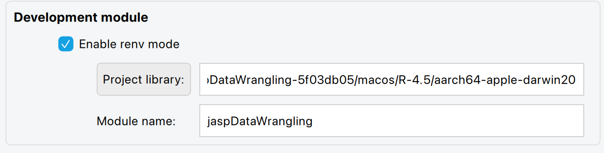

```{=html}
<button type="button" class="cs-toggle" id="cs-toggle" aria-expanded="false" aria-controls="cs-panel">📘 QML cheat sheet</button><aside class="cs-panel" id="cs-panel" aria-label="QML cheat sheet" hidden><div class="cs-head"><strong>📘 QML cheat sheet</strong><button type="button" class="cs-close" id="cs-close" aria-label="Close">✕</button></div><table data-quarto-disable-processing="true"><tr><th>🔁 Edit loop</th><td>Save → <code>renv::install(".")</code> → JASP: <b>Install Developer Module</b> → reopen the analysis</td></tr><tr><th>📂 Files</th><td><code>inst/Description.qml</code> = the menu<br><code>inst/qml/missingValues.qml</code> = the window<br><code>R/</code> = the computation (later!)</td></tr><tr><th>🧱 One control</th><td><code>CheckBox { name: "showPlot"; label: qsTr("Show plot") }</code><br><small>type · <b>name</b> (for R, later) · <b>label</b> (what users see)</small></td></tr><tr><th>☑️ CheckBox</th><td><code>CheckBox { name: "x"; label: qsTr("…"); checked: true }</code></td></tr><tr><th>✏️ TextField</th><td><code>TextField { name: "x"; label: qsTr("…"); defaultValue: "999" }</code></td></tr><tr><th>🔢 IntegerField / DoubleField</th><td><code>IntegerField { name: "x"; label: qsTr("…"); defaultValue: 2; min: 0; max: 10 }</code></td></tr><tr><th>🎚️ Slider</th><td><code>Slider { name: "x"; label: qsTr("…"); value: 1; min: 0; max: 5 }</code></td></tr><tr><th>🔽 DropDown</th><td><code>DropDown { name: "x"; label: qsTr("…"); values: ["A", "B"] }</code></td></tr><tr><th>🔘 RadioButtonGroup</th><td><code>RadioButtonGroup { name: "x"; title: qsTr("…")<br>&nbsp;&nbsp;RadioButton { value: "a"; label: qsTr("A"); checked: true } }</code></td></tr><tr><th>🗂️ Group</th><td><code>Group { title: qsTr("…")  …controls… }</code> · a titled box</td></tr><tr><th>📂 Section</th><td><code>Section { title: qsTr("…")  …controls… }</code> · folded away</td></tr><tr><th>🪆 Nesting</th><td>Put a control <b>inside</b> a CheckBox’s <code>{ }</code> → it’s greyed out until the box is ticked</td></tr><tr><th>⚠️ Three rules</th><td>Types start with a <b>Capital</b> · text goes in <b>"quotes"</b> · every <b>{</b> needs its <b>}</b></td></tr><tr><th>🆘 Stuck?</th><td>Menu gone → check brackets · Window won’t open → check spelling &amp; capitals of file names · Still stuck → compare with <code>controlPlayground.qml</code></td></tr></table></aside>
```


```{=html}
<!--
  ✏️ HOW TO EDIT (for Leo)
  ⚠️ Edit this file in "Source" mode, NOT "Visual" mode.
     Visual mode rewrites the ```{=html} blocks below into plain code and breaks the page.

  - Normal text: just type. A blank line starts a new paragraph.
  - ## Heading {#id}  = a new section. Section links live in ribbon.html (href="#id").
  - **bold**, *italic*, `code`.
  - - [ ] item   = a checkbox students can tick.
  - [⏱ 10 min]{.timing} [0:10–0:20]{.timing .clock} at the end of a ## heading = the time badges (shown on the right).
    Times count from the start of the session (0:00), because the two sessions start at different times.
  - Boxes start with ::: {.something} and end with :::
      .callout-note            -> grey note box
      .callout-note .option    -> an exercise section (collapse="true" = closed, "false" = open)
      .callout-warning         -> orange TODO box (for you only; delete when done)
  - ```{=html} ... ``` blocks hold the designed components (reveal card, cards, mini-lab).
    You can change the TEXT inside them; leave the <tags> and class="..." as they are.
  - Colours and styling live in style.css.
  - Click "Render" to rebuild session-01.html.
-->
```

## Before we begin [⏱ 5 min]{.timing} [0:00–0:05]{.timing .clock} {#before}

A quick check before we start. **Don't worry if something isn't ready yet:** we'll sort it out together in the first minutes.

::: prep
- [ ] 💻 Laptop
- [ ] 📶 Connected to the Wi-Fi
- [ ] 🧮 JASP (nightly build) installed · [download ↗](https://static.jasp-stats.org/Nightlies/){target="_blank"}
- [ ] 📊 R (**4.5 or newer**) and RStudio installed · [how to ↗](https://rstudio-education.github.io/hopr/starting.html){target="_blank"} · check your version: run `R.version.string` in RStudio
- [ ] 🛠️ Build tools, so R can compile packages
    - **Mac:** open Terminal and run `xcode-select --install` (if it says *already installed*: you're done 🎉)
    - **Windows:** install [Rtools45 ↗](https://cran.r-project.org/bin/windows/Rtools/){target="_blank"} (a big download, so best done before the session)
- [ ] 🐙 A GitHub account (know your username and password) · [sign up ↗](https://github.com/signup){target="_blank"}
- [ ] 💬 Joined our Mattermost channel · no account yet? Ask Leo for an invite
:::

```{=html}
<div class="mini-note"><strong>Something missing?</strong> Raise your hand. The first part of today involves some waiting while things install, so there's time to catch up.</div>
```

## Overview [⏱ 15 min]{.timing} [0:05–0:20]{.timing .clock} {#welcome}

The big picture: **what** we're building this term, **how** we'll get there, **what's in it** for you, **when** we meet, and what we'll do **today**.

### 🕵️ The mission

```{=html}
<div class="mission-intro"><span class="kicker">THIS TERM · SECRET MISSION</span><h3>Can you make JASP do something new?</h3><p>No coding experience required. Just bring your curiosity.</p><details class="reveal-card" id="intro-reveal"><summary><span>🎁 Reveal the mission</span><span class="reveal-hint">Click to unlock ↗</span></summary><div class="reveal-content"><span class="kicker">WELCOME TO THE TEAM</span><h3>You're not just using JASP. You're building it.</h3><p>Welcome to the <strong>JASP Student Developers Group</strong>! This term, we'll build a <strong>data-wrangling module</strong> together: step by step, session by session, until it's a tool real researchers can use.</p><h4>Meet our mystery dataset 🕵️</h4><p>It looks normal at first glance. What could be hiding in it?</p><div class="dataview"><table data-quarto-disable-processing="true"><thead><tr><th></th><th>ID</th><th>wave</th><th>Age</th><th>gender</th><th>Condition</th><th>anxiety_1</th><th>Anx3</th><th>anx_4R</th><th>ANXIETY 5</th><th>anx.6</th><th>…</th></tr></thead><tbody><tr><td>1</td><td>P001</td><td>pre</td><td>20</td><td>female</td><td>control</td><td>2</td><td>4</td><td>4</td><td>4</td><td>3</td><td>…</td></tr><tr><td>2</td><td>P001</td><td>follow-up</td><td>20</td><td>F</td><td>Control</td><td>2</td><td>2</td><td>3</td><td>4</td><td>3</td><td>…</td></tr><tr><td>3</td><td>P001</td><td>post</td><td>20</td><td>F</td><td>control</td><td>3</td><td>3</td><td>4</td><td>3</td><td class="missing-value"></td><td>…</td></tr><tr><td>4</td><td>P002</td><td>pre</td><td>31</td><td>Male</td><td>Treatment </td><td>3</td><td>3</td><td>3</td><td>4</td><td>3</td><td>…</td></tr><tr><td>5</td><td>P002</td><td>post</td><td>31</td><td>Male</td><td>Treatment </td><td>2</td><td>2</td><td>4</td><td>3</td><td class="missing-value"></td><td>…</td></tr></tbody></table></div><p class="micro-note">First 5 of 351 rows · 15 columns</p><div class="data-download"><a href="../data/calm_minds_mystery.csv" download>⬇️ Download the dataset (.csv)</a><a href="../data/codebook.html" target="_blank">📖 Codebook</a></div><p>Every tool we build will help us investigate the data. How many problems will we discover?</p></div></details></div>
```

### 🤔 But, how?

```{=html}
<p class="flip-hint">👆 Click a card to see what we'll build in each part</p>
<div class="journey-grid">
<button type="button" class="flip-card" aria-pressed="false"><div class="flip-inner">
<div class="journey-step flip-front"><div class="journey-emoji">🔎</div><span class="step-count">01 · STARTS BEFORE CHRISTMAS</span><h4>Diagnose</h4><p>Find missing values, inspect distributions, spot outliers.</p><div aria-hidden="true" class="mini-bars"><i style="height:32%"></i><i style="height:70%"></i><i style="height:43%"></i><i style="height:95%"></i><i style="height:56%"></i><i style="height:80%"></i></div><span class="flip-cue">What will we build? ↻</span></div>
<div class="journey-step flip-back"><span class="step-count">01 · DIAGNOSE · OUR TOOLS</span><ul class="tool-list"><li><b>📋 Missing-values report</b><small>Session 3</small></li><li><b>📊 Distribution check</b><small>January</small></li><li><b>🚩 Outlier check</b><small>January</small></li></ul><p>Each tool uncovers some of the dataset's secrets.</p><span class="flip-cue">↻ Back</span></div>
</div></button>
<div class="journey-connector">→</div>
<button type="button" class="flip-card" aria-pressed="false"><div class="flip-inner">
<div class="journey-step green flip-front"><div class="journey-emoji">🛠️</div><span class="step-count">02 · MOSTLY AFTER CHRISTMAS</span><h4>Fix</h4><p>Transform messy data, then export a clean dataset.</p><div aria-hidden="true" class="mini-clean"><span>?</span><span>✓</span><span>✓</span><span>✓</span><span>✓</span></div><span class="flip-cue">What will we build? ↻</span></div>
<div class="journey-step green flip-back"><span class="step-count">02 · FIX · OUR TOOLS</span><ul class="tool-list"><li><b>🔁 Reverse-score items</b><small>Sneak peek: Session 2</small></li><li><b>🧮 Recode &amp; compute variables</b><small>After Christmas</small></li><li><b>💾 Export a clean dataset</b><small>After Christmas</small></li></ul><p>Which fixes exactly? <strong>You decide</strong>, based on what we find.</p><span class="flip-cue">↻ Back</span></div>
</div></button>
</div>
```

### 🎒 Loot & side quests

```{=html}
<div class="loot" id="loot"><div class="loot-top"><p>What do you get out of this? Click a badge to unlock it.</p><span class="loot-count" aria-live="polite"><b id="loot-n">0</b> / 6 unlocked</span></div><div class="badge-grid"><button type="button" class="loot-badge" aria-pressed="false"><span class="badge-icon">🧑‍💻</span><span class="badge-lock">🔒</span><strong>R Programmer</strong><small>Write R functions that real software runs.</small></button><button type="button" class="loot-badge" aria-pressed="false"><span class="badge-icon">🎛️</span><span class="badge-lock">🔒</span><strong>Interface Builder</strong><small>Design analysis windows people click on.</small></button><button type="button" class="loot-badge" aria-pressed="false"><span class="badge-icon">🐙</span><span class="badge-lock">🔒</span><strong>Git Wizard</strong><small>Fork, clone, pull request: the open-source workflow.</small></button><button type="button" class="loot-badge" aria-pressed="false"><span class="badge-icon">🕵️</span><span class="badge-lock">🔒</span><strong>Data Detective</strong><small>Spot and fix messy data. Your thesis will thank you.</small></button><button type="button" class="loot-badge" aria-pressed="false"><span class="badge-icon">🚀</span><span class="badge-lock">🔒</span><strong>JASP Contributor</strong><small>Your code could end up in JASP, used by researchers worldwide.</small></button><button type="button" class="loot-badge" aria-pressed="false"><span class="badge-icon">🤝</span><span class="badge-lock">🔒</span><strong>Team Player</strong><small>Pair work, code review, and meeting the JASP team.</small></button></div>
<div class="side-quests"><span class="kicker">⚔️ OPTIONAL SIDE QUESTS</span><p>Not every contribution is code! Side quests are open to everyone, any time, including <strong>less coding-related work</strong>: writing a blog post about a new JASP module, or helping build an example library from real exam questions. Prefer coding? Fix a beginner-friendly issue on GitHub. Contact me anytime!</p></div></div>
```

### 📅 How we meet

```{=html}
<div class="worry"><div class="worry-q">😰 “I can’t code yet. How am I supposed to build a JASP module?”</div><div class="worry-a">That’s exactly what our meetings are for: <b>we show you, then you try</b>, one small step at a time.</div></div>
<div class="session-grid"><div><span>💡 THURSDAYS · 11:30–13:00</span><strong>Sessions</strong><em class="tagline">We show you how.</em><div class="tbar"><div class="seg blue" style="flex:60">💬 Explain<small>60 min</small></div><div class="seg green" style="flex:30">🧩 Practice<small>30 min</small></div></div></div><div><span>🧩 ALTERNATE THURSDAYS · 15:00–16:30</span><strong>Practicals</strong><em class="tagline">You try it, with backup.</em><div class="tbar"><div class="seg sky" style="flex:30">🔁 Recap<small>30 min</small></div><div class="seg teal" style="flex:30">❓ Q&amp;A<small>30 min</small></div><div class="seg green" style="flex:30">🧩 Practice<small>30 min</small></div></div></div></div>
<div class="faq-row"><details class="faq"><summary>🤔 What if I get stuck?</summary><p>Ask! Every practical has Q&amp;A time, and our Mattermost channel is open all week.</p></details><details class="faq"><summary>📅 I can’t come every week</summary><p>No problem. Pick your plan in the <a href="../index.html#my-cal">calendar on our homepage</a>.</p></details><details class="faq"><summary>📝 Is this graded?</summary><p>No grades. No tests. No stupid questions.</p></details></div>
<a class="cal-link" href="../index.html#my-cal">📅 See the full calendar on our homepage →</a>

```

### 🎯 Today's route

```{=html}
<div class="mission-win">🎯 <strong>Today's win:</strong> your own module runs in JASP, and you change its menu.</div>
<div class="route-strip"><a href="#intros">👋 Meet</a><b>→</b><a href="#token">⚙️ Set up</a><b>→</b><a href="#load">🚀 Load</a><b>→</b><a href="#structure">🧩 Explore</a><b>→</b><a href="#menu">📋 Your menu</a></div><p class="flip-hint">👆 Click a step to jump there</p>
```

### 👋 Your turn: introductions {#intros}

Before we touch any code: who's here?

```{=html}
<div class="intro-chips"><span>🙋 Your name</span><span>🎓 Your programme</span><span>💛 Your favorite thing</span></div>
```

## Get the module & a GitHub token [⏱ 5 min]{.timing} [0:20–0:25]{.timing .clock} {#token}

::::: {.steps}
:::: {.step}
[🌐 Browser]{.app .app-web} [Grab the module]{.step-title}

Download the starter module and unzip it somewhere you'll find again (e.g. your Documents folder).

```{=html}
<div class="data-download"><a href="../module/jaspDataWrangling.zip" download>⬇️ Download jaspDataWrangling.zip</a></div>
```
::::

:::: {.step}
[🐙 GitHub]{.app .app-gh} [Create a token]{.step-title}

Logged in to GitHub? Open <https://github.com/settings/tokens/new> and fill in:

```{=html}
<div class="token-form">
  <div><span>Note</span><code>JASP</code></div>
  <div><span>Expiration</span><code>90 days</code></div>
  <div class="tick-nothing"><span>Scopes</span><b>☐ tick nothing!</b></div>
  <div><span>Then</span><b>Generate token ↓</b></div>
</div>
<details class="stuck"><summary>🤔 Why a token at all?</summary><p>Our module downloads two packages (<code>jaspBase</code>, <code>jaspGraphs</code>) from GitHub. Without a login, GitHub allows only <strong>60 requests per hour per network</strong>, and the whole room shares one network. A token gives each of you your own allowance. With no boxes ticked, it can only read public stuff, so it can't do any harm.</p></details>
```

::: {.callout-important icon="false"}
## Copy it now!

GitHub shows the token (`ghp_...`) **only once**. Lost it? No drama: just make a new one.
:::
::::

:::: {.step}
[📊 RStudio]{.app .app-r} [Hand the token to R]{.step-title}

Open RStudio (**just RStudio, not the project yet**) and run in the Console:

``` r
file.edit("~/.Renviron")
```

Add this line with your own token, **press Enter once** (R can skip a last line without a line break 🙃), and save:

``` text
GITHUB_PAT=ghp_paste-your-token-here
```

```{=html}
<details class="stuck"><summary>🤔 Why this file?</summary><p><code>.Renviron</code> is read every time R starts, so you only do this once on this computer. R picks it up in the <strong>next</strong> R session, which starts automatically when you open the project.</p></details>
```
::::
:::::

- [ ] Module downloaded & unzipped
- [ ] Logged in to GitHub
- [ ] Token generated and copied
- [ ] `GITHUB_PAT=...` saved in `.Renviron`

## Install the module [⏱ 20 min]{.timing} [0:25–0:45]{.timing .clock} {#install}

::::: {.steps}
:::: {.step}
[📁 Finder / Explorer]{.app .app-files} [Open the project]{.step-title}

Double-click `jaspDataWrangling.Rproj`. RStudio's Console should greet you with:

``` text
- Project '~/.../jaspDataWrangling' loaded. [renv 1.x.x]
```

```{=html}
<details class="stuck"><summary>😵 No such line?</summary><p>RStudio didn't open it as a project. Use <strong>File → Open Project…</strong> and pick the <code>.Rproj</code> file.</p></details>
```
::::

:::: {.step}
[📊 RStudio]{.app .app-r} [Did the token arrive?]{.step-title}

``` r
Sys.getenv("GITHUB_PAT")
```

It should print something starting with `ghp_`.

```{=html}
<details class="stuck"><summary>😵 It prints an empty ""</summary><p>R hasn't read your <code>.Renviron</code> yet. <strong>Session → Restart R</strong>, then try again.</p></details>
```
::::

:::: {.step}
[📊 RStudio]{.app .app-r} [Install everything]{.step-title}

``` r
renv::install(".")
```

Sit back ☕ This compiles a few packages and takes a while. You're done when R says `Successfully installed`.

```{=html}
<details class="stuck"><summary>😵 Red ERROR somewhere?</summary><p>Scroll <strong>up</strong> to the <em>first</em> red ERROR: that's the real cause. <code>dependency 'X' is not available</code> only means X failed earlier. Screenshot that first error and wave at Leo 👋</p></details>
```
::::
:::::

- [ ] Project opened (saw the `Project ... loaded` line)
- [ ] Installation finished (`Successfully installed ...`)

## Load the module in JASP [⏱ 10 min]{.timing} [0:45–0:55]{.timing .clock} {#load}

::::: {.steps}
:::: {.step}
[🧮 JASP]{.app .app-jasp} [Open the developer settings]{.step-title}

Menu (☰, top left) → **Preferences** → **Advanced**. Find the **Development module** box and keep this window open.
::::

:::: {.step}
[📊 RStudio]{.app .app-r} [Find where renv put everything]{.step-title}

With the project still open, run:

``` r
.libPaths()
```

Copy the **first** path, the one marked `[1]`. It contains `jaspDataWrangling` and ends with your R version and computer type, something like:

``` text
[1] "/Users/you/.../jaspDataWrangling-5f03db05/macos/R-4.5/aarch64-apple-darwin20"
```

Copy only the path itself: no `[1]`, no quotes.
::::

:::: {.step}
[🧮 JASP]{.app .app-jasp} [Paste it]{.step-title}

Under **Development module**: tick **Enable renv mode**, paste the path into **Project library**, and type `jaspDataWrangling` as **Module name**.

{width=560 fig-alt="JASP Development module settings: Enable renv mode ticked, Project library path, Module name jaspDataWrangling"}
::::

:::: {.step .step-final}
[🧮 JASP]{.app .app-jasp} [Lift-off!]{.step-title}

Click **Install Developer Module**. A **Data Wrangling** button appears on the ribbon 🎉 Open **Control Playground** and poke every control: watch the text, table and plot react. Then peek at **Missing Values**: that's the one you'll build.
::::
:::::

- [ ] Enable renv mode ticked
- [ ] Library path pasted
- [ ] Module visible in the JASP menu 🎉

## How a JASP module works [⏱ 15 min]{.timing} [0:55–1:10]{.timing .clock} {#structure}

You just played with **Control Playground**. Time to open the hood! A JASP module is an **R package** with a few extra files for the JASP interface. Every analysis is made of three pieces:

```{=html}
<div class="anatomy-grid"><div class="anatomy-node"><div class="anatomy-icon">📋</div><strong>Description.qml</strong><span>Menu entry</span><small>Puts “Control Playground” in the ribbon</small></div><div class="anatomy-arrow">→</div><div class="anatomy-node"><div class="anatomy-icon">🎛️</div><strong>controlPlayground.qml</strong><span>Controls</span><small>The left panel you clicked</small></div><div class="anatomy-arrow">→</div><div class="anatomy-node"><div class="anatomy-icon">📊</div><strong>controlPlayground.R</strong><span>Computation</span><small>The text, table &amp; plot on the right</small></div></div>
<div class="ft" id="file-tree"><div class="ft-head">📂 What’s in the box? <small>Click any file or folder</small></div><div class="ft-body"><div class="ft-tree" role="tree"><button type="button" class="ft-row ft-dir" data-key="root" data-depth="0" style="--d:0"><span class="ft-caret">▾</span>📁 <code>jaspDataWrangling/</code><span class="ft-dot t-today"></span></button><button type="button" class="ft-row ft-file" data-key="DESCRIPTION" data-depth="1" style="--d:1"><span class="ft-caret"></span>📄 <code>DESCRIPTION</code><span class="ft-dot t-later"></span></button><button type="button" class="ft-row ft-file" data-key="NAMESPACE" data-depth="1" style="--d:1"><span class="ft-caret"></span>📄 <code>NAMESPACE</code><span class="ft-dot t-later"></span></button><button type="button" class="ft-row ft-dir" data-key="R" data-depth="1" style="--d:1"><span class="ft-caret">▾</span>📁 <code>R/</code><span class="ft-dot t-later"></span></button><button type="button" class="ft-row ft-file" data-key="controlPlaygroundR" data-depth="2" style="--d:2"><span class="ft-caret"></span>📄 <code>controlPlayground.R</code><span class="ft-dot t-later"></span></button><button type="button" class="ft-row ft-file" data-key="missingValuesR" data-depth="2" style="--d:2"><span class="ft-caret"></span>📄 <code>missingValues.R</code><span class="ft-dot t-later"></span></button><button type="button" class="ft-row ft-file" data-key="commonR" data-depth="2" style="--d:2"><span class="ft-caret"></span>📄 <code>common.R</code><span class="ft-dot t-later"></span></button><button type="button" class="ft-row ft-dir" data-key="inst" data-depth="1" style="--d:1"><span class="ft-caret">▾</span>📁 <code>inst/</code><span class="ft-dot t-today"></span></button><button type="button" class="ft-row ft-file" data-key="Description" data-depth="2" style="--d:2"><span class="ft-caret"></span>📄 <code>Description.qml</code><span class="ft-dot t-today"></span></button><button type="button" class="ft-row ft-dir" data-key="icons" data-depth="2" style="--d:2"><span class="ft-caret"></span>📁 <code>icons/</code><span class="ft-dot t-later"></span></button><button type="button" class="ft-row ft-dir" data-key="qml" data-depth="2" style="--d:2"><span class="ft-caret">▾</span>📁 <code>qml/</code><span class="ft-dot t-today"></span></button><button type="button" class="ft-row ft-file" data-key="controlPlaygroundQml" data-depth="3" style="--d:3"><span class="ft-caret"></span>📄 <code>controlPlayground.qml</code><span class="ft-dot t-today"></span></button><button type="button" class="ft-row ft-file" data-key="missingValuesQml" data-depth="3" style="--d:3"><span class="ft-caret"></span>📄 <code>missingValues.qml</code><span class="ft-dot t-today"></span></button><button type="button" class="ft-row ft-file" data-key="renv" data-depth="1" style="--d:1"><span class="ft-caret"></span>📄 <code>renv/ · renv.lock · .Rprofile</code><span class="ft-dot t-never"></span></button><button type="button" class="ft-row ft-file" data-key="Rproj" data-depth="1" style="--d:1"><span class="ft-caret"></span>📄 <code>jaspDataWrangling.Rproj</code><span class="ft-dot t-today"></span></button><button type="button" class="ft-row ft-file" data-key="README" data-depth="1" style="--d:1"><span class="ft-caret"></span>📄 <code>README.md</code><span class="ft-dot t-later"></span></button></div><div class="ft-info" id="ft-info" aria-live="polite"><div class="ft-empty">👈 Pick a file to find out what it does.<br><br><span class="ft-legend"><span class="ft-dot t-today"></span> today <span class="ft-dot t-later"></span> later <span class="ft-dot t-never"></span> don’t touch</span></div></div></div><script type="application/json" id="ft-data">{"root": {"icon": "📦", "title": "The whole module", "text": "A JASP module is just an R package with a few extra files for JASP. Everything lives in this one folder.", "tag": "✏️ You’ll use this today", "cls": "t-today"}, "DESCRIPTION": {"icon": "🪪", "title": "The ID card", "text": "The package’s name, version, authors and which other packages it needs (here: jaspBase and jaspGraphs).", "tag": "👀 Comes later", "cls": "t-later"}, "NAMESPACE": {"icon": "🚪", "title": "The guest list", "text": "Lists which R functions JASP is allowed to call. Add a new analysis? Its function has to be on this list, or JASP says “could not find function”.", "tag": "👀 Comes later", "cls": "t-later"}, "R": {"icon": "🧮", "title": "The brains", "text": "All the R code: the calculations behind each analysis. One file per analysis.", "tag": "👀 Comes later", "cls": "t-later"}, "controlPlaygroundR": {"icon": "📊", "title": "Control Playground: computation", "text": "Reads what you clicked, simulates data, and builds the text, table and histogram you saw on the right.", "tag": "👀 Comes later", "cls": "t-later"}, "missingValuesR": {"icon": "📊", "title": "Missing Values: computation", "text": "For now it only shows what R received. In Session 3 it will start counting the holes in your data.", "tag": "👀 Comes later", "cls": "t-later"}, "commonR": {"icon": "🧰", "title": "The toolbox", "text": "Small helper functions that both analyses share.", "tag": "👀 Comes later", "cls": "t-later"}, "inst": {"icon": "🎨", "title": "The JASP side", "text": "Everything JASP itself reads: the menu, the windows and the icon.", "tag": "✏️ You’ll use this today", "cls": "t-today"}, "Description": {"icon": "📋", "title": "The menu", "text": "Decides what appears when you click Data Wrangling: the headings and which analyses you can open.", "tag": "✏️ You’ll use this today", "cls": "t-today"}, "icons": {"icon": "🖼️", "title": "The icon", "text": "The picture on the ribbon button.", "tag": "👀 Comes later", "cls": "t-later"}, "qml": {"icon": "🎛️", "title": "The windows", "text": "One QML file per analysis: the controls in the left panel.", "tag": "✏️ You’ll use this today", "cls": "t-today"}, "controlPlaygroundQml": {"icon": "🎛️", "title": "Control Playground: window", "text": "Every control you played with: text field, slider, dropdown… A great place to copy from.", "tag": "✏️ You’ll use this today", "cls": "t-today"}, "missingValuesQml": {"icon": "🎛️", "title": "Missing Values: window", "text": "Your workbench: this is where your first button goes (Session 2).", "tag": "✏️ You’ll use this today", "cls": "t-today"}, "renv": {"icon": "🔒", "title": "The lock", "text": "renv remembers the exact package versions, so everyone’s module behaves the same. It runs by itself when you open the project.", "tag": "🚫 Don’t touch", "cls": "t-never"}, "Rproj": {"icon": "🚀", "title": "The launcher", "text": "Double-click it to open the project in RStudio (and switch renv on).", "tag": "✏️ You’ll use this today", "cls": "t-today"}, "README": {"icon": "📖", "title": "The manual", "text": "How to install the module and add a new analysis. Read it when you forget a step.", "tag": "👀 Comes later", "cls": "t-later"}}</script></div>
```

### 📋 Start with the menu {#menu}

The easiest piece to see: `inst/Description.qml` decides what appears when you click **Data Wrangling** on the ribbon. Open it and compare it with the menu in JASP:

``` qml
GroupTitle
{
    title: qsTr("Playground")              // a heading in the menu
}

Analysis
{
    title: qsTr("Control Playground")      // an item you can click
    func : "controlPlayground"             // the R function it runs
    qml  : "controlPlayground.qml"         // the window it opens
}
```

**Your first edit:** add a heading of your own to the **Data Wrangling** menu. Any title you like! No code given this time: the snippet above has everything you need.

When you're done: save → in RStudio's Console run `renv::install(".")` → in JASP, **Install Developer Module** again → click **Data Wrangling**.

```{=html}
<details class="stuck"><summary>💡 Hint 1</summary><p>How did the heading <em>“Playground”</em> get into the menu? Find that word in <code>Description.qml</code>.</p></details>
<details class="stuck"><summary>💡 Hint 2</summary><p>You need a new block of the same type as the one around <em>“Playground”</em>. Copy it, change one thing. Where you paste it decides where it appears.</p></details>
<details class="stuck"><summary>🔓 Still stuck? Show the answer</summary><pre><code>GroupTitle
{
    title: qsTr("My corner")
}</code></pre><p>Paste it just above the last <code>}</code> of the file, so it lands at the bottom of the menu.</p></details>
```

- [ ] My heading shows up in the menu
- [ ] Bonus: move it *between* Control Playground and Missing Values. What changes?

```{=html}
<a class="continued" href="../session-02/session-02.html"><span class="continued-icon">➡️</span><span><strong>To be continued in Session 2</strong><small>Bug hunt, your first button, and your first R code</small></span><span class="continued-go">Open →</span></a>
```

## Wrap-up [⏱ 5 min]{.timing} [1:10–1:15]{.timing .clock} {#wrapup}

### 🏆 Achievements unlocked

Your badges light up by themselves as you tick off the missions on this page. How many did you collect?

```{=html}
<div class="ach" id="ach">
  <div class="ach-top"><span class="ach-count" aria-live="polite"><b id="ach-n">0</b> / 3</span><span class="ach-bar"><i id="ach-bar"></i></span></div>
  <div class="badge-grid ach-grid">
    <div class="loot-badge ach-badge" data-need="before"><span class="badge-icon">🎒</span><span class="badge-lock">🔒</span><strong>Well Prepared</strong><small>Laptop, tools and accounts: all set.</small></div>
    <div class="loot-badge ach-badge" data-need="install,load"><span class="badge-icon">⚙️</span><span class="badge-lock">🔒</span><strong>Setup Survivor</strong><small>Your own JASP module runs on your laptop.</small></div>
    <div class="loot-badge ach-badge" data-need="menu:1"><span class="badge-icon">📋</span><span class="badge-lock">🔒</span><strong>Menu Maker</strong><small>You changed what JASP shows in its menu.</small></div>
  </div>
  <p class="ach-done" id="ach-done" hidden>🎉 Full house! See you at the next session.</p>
</div>
```

### 📅 What's next

```{=html}
<div class="next-cards">
  <div class="next-card practical"><span class="next-when">Thu 19 Nov · 15:00–16:30 · 📍 REC GS.34</span><strong>🧩 Practical 1: R Puzzles</strong><p>20 puzzles with the mystery dataset, from zero R to writing your own functions. Pick your level! Also the place to fix any leftover setup problems.</p></div>
  <a class="next-card session" href="../session-02/session-02.html"><span class="next-when">Thu 26 Nov · 11:30–13:00 · 📍 REC JKK.26</span><strong>💡 Session 2: From Button to Output →</strong><p>We pick up where we stopped: a bug hunt, your first button, and your first R code.</p></a>
</div>
```

```{=html}
<div class="next-chips"><span>🆘 Something broke at home? Post it on Mattermost, or bring your laptop to the practical.</span><span>👀 Curious? Peek at the other files in <code>inst/qml/</code>. What else could you change?</span></div>
```

::: {.callout-note icon="false"}
## 🕵️ A first peek

Next week, in R Puzzles, you'll compute a simple average from the mystery dataset… and something will look *very* wrong.
:::

### 🧭 Curious what else you could work on?

Have a look at our list of potential student projects: ideas from the JASP team, ideas from other students, and beginner-friendly issues on GitHub. Some involve a lot of coding, some hardly any.

```{=html}
<div class="data-download"><a href="https://docs.google.com/spreadsheets/d/1SUtcm54EjAVyw6KdJ-t5AjNIC07EKB0Yocrb1vaSB7M/edit?usp=sharing" target="_blank" rel="noopener">📋 Potential student projects ↗</a></div>
```


```{=html}
<div class="sign-off"><span class="sign-wave">👋</span><strong>Thank you for building with us today!</strong><p>Until next time, and happy coding.</p><em>Leo &amp; the JASP Student Developers</em></div>
```
