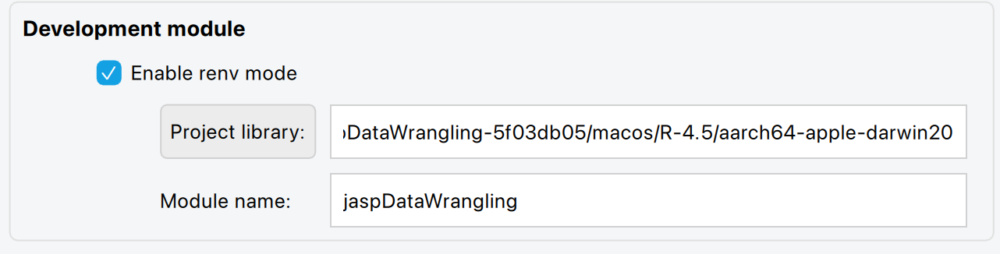
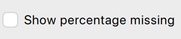
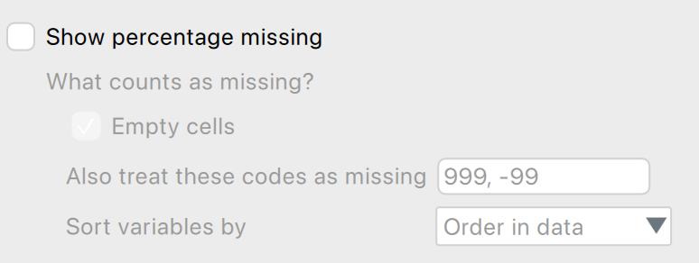
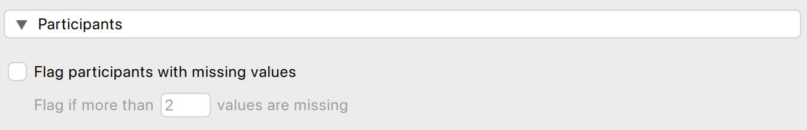

```{=html}
<a class="stop-jump" href="#stopped">📍 Jump to where we stopped</a>
```

```{=html}
<button type="button" class="cs-toggle" id="cs-toggle" aria-expanded="false" aria-controls="cs-panel">📘 QML cheat sheet</button><aside class="cs-panel" id="cs-panel" aria-label="QML cheat sheet" hidden><div class="cs-head"><strong>📘 QML cheat sheet</strong><button type="button" class="cs-close" id="cs-close" aria-label="Close">✕</button></div><table data-quarto-disable-processing="true"><tr><th>🔁 Edit loop</th><td>Save → <code>renv::install(".")</code> → JASP: <b>Install Developer Module</b> → reopen the analysis</td></tr><tr><th>📂 Files</th><td><code>inst/Description.qml</code> = the menu<br><code>inst/qml/missingValues.qml</code> = the window<br><code>R/</code> = the computation (later!)</td></tr><tr><th>🧱 One control</th><td><code>CheckBox { name: "showPlot"; label: qsTr("Show plot") }</code><br><small>type · <b>name</b> (for R, later) · <b>label</b> (what users see)</small></td></tr><tr><th>☑️ CheckBox</th><td><code>CheckBox { name: "x"; label: qsTr("…"); checked: true }</code></td></tr><tr><th>✏️ TextField</th><td><code>TextField { name: "x"; label: qsTr("…"); defaultValue: "999" }</code></td></tr><tr><th>🔢 IntegerField / DoubleField</th><td><code>IntegerField { name: "x"; label: qsTr("…"); defaultValue: 2; min: 0; max: 10 }</code></td></tr><tr><th>🎚️ Slider</th><td><code>Slider { name: "x"; label: qsTr("…"); value: 1; min: 0; max: 5 }</code></td></tr><tr><th>🔽 DropDown</th><td><code>DropDown { name: "x"; label: qsTr("…"); values: ["A", "B"] }</code></td></tr><tr><th>🔘 RadioButtonGroup</th><td><code>RadioButtonGroup { name: "x"; title: qsTr("…")<br>&nbsp;&nbsp;RadioButton { value: "a"; label: qsTr("A"); checked: true } }</code></td></tr><tr><th>🗂️ Group</th><td><code>Group { title: qsTr("…")  …controls… }</code> · a titled box</td></tr><tr><th>📂 Section</th><td><code>Section { title: qsTr("…")  …controls… }</code> · folded away</td></tr><tr><th>🪆 Nesting</th><td>Put a control <b>inside</b> a CheckBox’s <code>{ }</code> → it’s greyed out until the box is ticked</td></tr><tr><th>⚠️ Three rules</th><td>Types start with a <b>Capital</b> · text goes in <b>"quotes"</b> · every <b>{</b> needs its <b>}</b></td></tr><tr><th>🆘 Stuck?</th><td>Menu gone → check brackets · Window won’t open → check spelling &amp; capitals of file names · Still stuck → compare with <code>controlPlayground.qml</code></td></tr></table></aside>
```


```{=html}
<!--
  ✏️ HOW TO EDIT (for Leo)
  ⚠️ Edit this file in "Source" mode, NOT "Visual" mode.
     Visual mode rewrites the ```{=html} blocks below into plain code and breaks the page.

  - Normal text: just type. A blank line starts a new paragraph.
  - ## Heading {#id}  = a new section. Section links live in ribbon.html (href="#id").
  - **bold**, *italic*, `code`.
  - - [ ] item   = a checkbox students can tick.
  - [⏱ 10 min]{.timing} [0:10–0:20]{.timing .clock} at the end of a ## heading = the time badges (shown on the right).
    Times count from the start of the session (0:00), because the two sessions start at different times.
  - Boxes start with ::: {.something} and end with :::
      .callout-note            -> grey note box
      .callout-note .option    -> an exercise section (collapse="true" = closed, "false" = open)
      .callout-warning         -> orange TODO box (for you only; delete when done)
  - ```{=html} ... ``` blocks hold the designed components (reveal card, cards, mini-lab).
    You can change the TEXT inside them; leave the <tags> and class="..." as they are.
  - Colours and styling live in style.css.
  - Click "Render" to rebuild session-01.html.
-->
```

## Before we begin [⏱ 5 min]{.timing} [0:00–0:05]{.timing .clock} {#before}

A quick check before we start. **Don't worry if something isn't ready yet:** we'll sort it out together in the first minutes.

::: prep
- [ ] 💻 Laptop
- [ ] 📶 Connected to the Wi-Fi
- [ ] 🧮 JASP (nightly build) installed · [download ↗](https://static.jasp-stats.org/Nightlies/){target="_blank"}
- [ ] 📊 R (**4.5 or newer**) and RStudio installed · [how to ↗](https://rstudio-education.github.io/hopr/starting.html){target="_blank"} · check your version: run `R.version.string` in RStudio
- [ ] 🛠️ Build tools, so R can compile packages
    - **Mac:** open Terminal and run `xcode-select --install` (if it says *already installed*: you're done 🎉)
    - **Windows:** install [Rtools45 ↗](https://cran.r-project.org/bin/windows/Rtools/){target="_blank"} (a big download, so best done before the session)
- [ ] 🐙 A GitHub account (know your username and password) · [sign up ↗](https://github.com/signup){target="_blank"}
- [ ] 💬 Joined our Mattermost channel · [join here ↗](https://mattermost.jaspcom.xyz/signup_user_complete/?id=uc1d54mao7ndfpzxydeah9a86r){target="_blank"}
:::

```{=html}
<div class="mini-note"><strong>Something missing?</strong> Raise your hand. The first part of today involves some waiting while things install, so there's time to catch up.</div>
```

## Overview [⏱ 15 min]{.timing} [0:05–0:20]{.timing .clock} {#welcome}

The big picture: **what** we're building this term, **how** we'll get there, **what's in it** for you, **when** we meet, and what we'll do **today**.

### 🕵️ The mission

```{=html}
<div class="mission-intro"><span class="kicker">THIS TERM · SECRET MISSION</span><h3>Can you make JASP do something new?</h3><p>No coding experience required. Just bring your curiosity.</p><details class="reveal-card" id="intro-reveal"><summary><span>🎁 Reveal the mission</span><span class="reveal-hint">Click to unlock ↗</span></summary><div class="reveal-content"><span class="kicker">WELCOME TO THE TEAM</span><h3>You're not just using JASP. You're building it.</h3><p>Welcome to the <strong>JASP Student Developers Group</strong>! This term, we'll build a <strong>data-wrangling module</strong> together: step by step, session by session, until it's a tool real researchers can use.</p><h4>Meet our mystery dataset 🕵️</h4><p>It looks normal at first glance. What could be hiding in it?</p><div class="dataview"><table data-quarto-disable-processing="true"><thead><tr><th></th><th>ID</th><th>wave</th><th>Age</th><th>gender</th><th>Condition</th><th>anxiety_1</th><th>Anx3</th><th>anx_4R</th><th>ANXIETY 5</th><th>anx.6</th><th>…</th></tr></thead><tbody><tr><td>1</td><td>P001</td><td>pre</td><td>20</td><td>female</td><td>control</td><td>2</td><td>4</td><td>4</td><td>4</td><td>3</td><td>…</td></tr><tr><td>2</td><td>P001</td><td>follow-up</td><td>20</td><td>F</td><td>Control</td><td>2</td><td>2</td><td>3</td><td>4</td><td>3</td><td>…</td></tr><tr><td>3</td><td>P001</td><td>post</td><td>20</td><td>F</td><td>control</td><td>3</td><td>3</td><td>4</td><td>3</td><td class="missing-value"></td><td>…</td></tr><tr><td>4</td><td>P002</td><td>pre</td><td>31</td><td>Male</td><td>Treatment </td><td>3</td><td>3</td><td>3</td><td>4</td><td>3</td><td>…</td></tr><tr><td>5</td><td>P002</td><td>post</td><td>31</td><td>Male</td><td>Treatment </td><td>2</td><td>2</td><td>4</td><td>3</td><td class="missing-value"></td><td>…</td></tr></tbody></table></div><p class="micro-note">First 5 of 351 rows · 15 columns</p><div class="data-download"><a href="../data/calm_minds_mystery.csv" download>⬇️ Download the dataset (.csv)</a><a href="../data/codebook.html" target="_blank">📖 Codebook</a></div><p>Every tool we build will help us investigate the data. How many problems will we discover?</p></div></details></div>
```

### 🤔 But, how?

```{=html}
<p class="flip-hint">👆 Click a card to see what we'll build in each part</p>
<div class="journey-grid">
<button type="button" class="flip-card" aria-pressed="false"><div class="flip-inner">
<div class="journey-step flip-front"><div class="journey-emoji">🔎</div><span class="step-count">01 · STARTS BEFORE CHRISTMAS</span><h4>Diagnose</h4><p>Find missing values, inspect distributions, spot outliers.</p><div aria-hidden="true" class="mini-bars"><i style="height:32%"></i><i style="height:70%"></i><i style="height:43%"></i><i style="height:95%"></i><i style="height:56%"></i><i style="height:80%"></i></div><span class="flip-cue">What will we build? ↻</span></div>
<div class="journey-step flip-back"><span class="step-count">01 · DIAGNOSE · OUR TOOLS</span><ul class="tool-list"><li><b>📋 Missing-values report</b><small>Session 3</small></li><li><b>📊 Distribution check</b><small>January</small></li><li><b>🚩 Outlier check</b><small>January</small></li></ul><p>Each tool uncovers some of the dataset's secrets.</p><span class="flip-cue">↻ Back</span></div>
</div></button>
<div class="journey-connector">→</div>
<button type="button" class="flip-card" aria-pressed="false"><div class="flip-inner">
<div class="journey-step green flip-front"><div class="journey-emoji">🛠️</div><span class="step-count">02 · MOSTLY AFTER CHRISTMAS</span><h4>Fix</h4><p>Transform messy data, then export a clean dataset.</p><div aria-hidden="true" class="mini-clean"><span>?</span><span>✓</span><span>✓</span><span>✓</span><span>✓</span></div><span class="flip-cue">What will we build? ↻</span></div>
<div class="journey-step green flip-back"><span class="step-count">02 · FIX · OUR TOOLS</span><ul class="tool-list"><li><b>🔁 Reverse-score items</b><small>Sneak peek: Session 2</small></li><li><b>🧮 Recode &amp; compute variables</b><small>After Christmas</small></li><li><b>💾 Export a clean dataset</b><small>After Christmas</small></li></ul><p>Which fixes exactly? <strong>You decide</strong>, based on what we find.</p><span class="flip-cue">↻ Back</span></div>
</div></button>
</div>
```

### 🎒 Loot & side quests

```{=html}
<div class="loot" id="loot"><div class="loot-top"><p>What do you get out of this? Click a badge to unlock it.</p><span class="loot-count" aria-live="polite"><b id="loot-n">0</b> / 6 unlocked</span></div><div class="badge-grid"><button type="button" class="loot-badge" aria-pressed="false"><span class="badge-icon">🧑‍💻</span><span class="badge-lock">🔒</span><strong>R Programmer</strong><small>Write R functions that real software runs.</small></button><button type="button" class="loot-badge" aria-pressed="false"><span class="badge-icon">🎛️</span><span class="badge-lock">🔒</span><strong>Interface Builder</strong><small>Design analysis windows people click on.</small></button><button type="button" class="loot-badge" aria-pressed="false"><span class="badge-icon">🐙</span><span class="badge-lock">🔒</span><strong>Git Wizard</strong><small>Fork, clone, pull request: the open-source workflow.</small></button><button type="button" class="loot-badge" aria-pressed="false"><span class="badge-icon">🕵️</span><span class="badge-lock">🔒</span><strong>Data Detective</strong><small>Spot and fix messy data. Your thesis will thank you.</small></button><button type="button" class="loot-badge" aria-pressed="false"><span class="badge-icon">🚀</span><span class="badge-lock">🔒</span><strong>JASP Contributor</strong><small>Your code could end up in JASP, used by researchers worldwide.</small></button><button type="button" class="loot-badge" aria-pressed="false"><span class="badge-icon">🤝</span><span class="badge-lock">🔒</span><strong>Team Player</strong><small>Pair work, code review, and meeting the JASP team.</small></button></div>
<div class="side-quests"><span class="kicker">⚔️ OPTIONAL SIDE QUESTS</span><p>Not every contribution is code! Side quests are open to everyone, any time, including <strong>less coding-related work</strong>: writing a blog post about a new JASP module, or helping build an example library from real exam questions. Prefer coding? Fix a beginner-friendly issue on GitHub. Contact me anytime!</p></div></div>
```

### 📅 How we meet

```{=html}
<div class="worry"><div class="worry-q">😰 “I can’t code yet. How am I supposed to build a JASP module?”</div><div class="worry-a">That’s exactly what our meetings are for: <b>we show you, then you try</b>, one small step at a time.</div></div>
<div class="session-grid"><div><span>💡 THURSDAYS · 11:30–13:00</span><strong>Sessions</strong><em class="tagline">We show you how.</em><div class="tbar"><div class="seg blue" style="flex:60">💬 Explain<small>60 min</small></div><div class="seg green" style="flex:30">🧩 Practice<small>30 min</small></div></div></div><div><span>🧩 ALTERNATE THURSDAYS · 15:00–16:30</span><strong>Practicals</strong><em class="tagline">You try it, with backup.</em><div class="tbar"><div class="seg sky" style="flex:30">🔁 Recap<small>30 min</small></div><div class="seg teal" style="flex:30">❓ Q&amp;A<small>30 min</small></div><div class="seg green" style="flex:30">🧩 Practice<small>30 min</small></div></div></div></div>
<div class="faq-row"><details class="faq"><summary>🤔 What if I get stuck?</summary><p>Ask! Every practical has Q&amp;A time, and our Mattermost channel is open all week.</p></details><details class="faq"><summary>📅 I can’t come every week</summary><p>No problem. Pick your plan in the calendar below 👇</p></details><details class="faq"><summary>📝 Is this graded?</summary><p>No grades. No tests. No stupid questions.</p></details></div>
<div class="cal" id="my-cal" data-mode="both"><div class="cal-top"><strong>Until Christmas</strong><span class="cal-legend"><i class="session"></i>Session <i class="practical"></i>Practical</span></div><div class="cal-ask"><span>Which can you make?</span><div class="cal-modes" role="group" aria-label="Which meetings can you attend?"><button type="button" data-mode="both" aria-pressed="true">🙌 Both</button><button type="button" data-mode="sessions" aria-pressed="false">💡 Sessions only</button><button type="button" data-mode="practicals" aria-pressed="false">🧩 Practicals only</button></div></div><p class="cal-summary" id="cal-summary" aria-live="polite"></p><div class="cal-grid"><div class="cal-head">Mon</div><div class="cal-head">Tue</div><div class="cal-head">Wed</div><div class="cal-head">Thu</div><div class="cal-head">Fri</div><div class="cal-day"><span class="cal-num">9 <em>Nov</em></span></div><div class="cal-day"><span class="cal-num">10</span></div><div class="cal-day"><span class="cal-num">11</span></div><div class="cal-day has-session"><span class="cal-num">12</span><div class="cal-ev session" data-both="go" data-note-both="Pick one of the two runs" data-sessions="go" data-note-sessions="" data-practicals="skip" data-note-practicals="Come on Tue 17 instead"><b>Session 1</b><small>11:30–13:00</small><small class="cal-room">📍 REC L0.10</small><em class="cal-note"></em></div></div><div class="cal-day"><span class="cal-num">13</span></div><div class="cal-day"><span class="cal-num">16</span></div><div class="cal-day has-session"><span class="cal-num">17</span><div class="cal-ev session" data-both="alt" data-note-both="…or this run" data-sessions="alt" data-note-sessions="Backup run" data-practicals="go" data-note-practicals="Your Session 1"><b>Session 1 · 2nd run</b><small>13:00–14:30</small><small class="cal-room">📍 REC GS.34</small><em class="cal-note"></em></div></div><div class="cal-day"><span class="cal-num">18</span></div><div class="cal-day has-practical"><span class="cal-num">19</span><div class="cal-ev practical" data-both="go" data-note-both="Optional if you know R" data-sessions="skip" data-note-sessions="Materials posted online" data-practicals="go" data-note-practicals=""><b>Practical 1 · R Puzzle Lab</b><small>15:00–16:30</small><small class="cal-room">📍 REC GS.34</small><em class="cal-note"></em></div></div><div class="cal-day"><span class="cal-num">20</span></div><div class="cal-day"><span class="cal-num">23</span></div><div class="cal-day"><span class="cal-num">24</span></div><div class="cal-day"><span class="cal-num">25</span></div><div class="cal-day has-session"><span class="cal-num">26</span><div class="cal-ev session" data-both="go" data-note-both="" data-sessions="go" data-note-sessions="" data-practicals="skip" data-note-practicals="Materials shared after class"><b>Session 2</b><small>11:30–13:00</small><small class="cal-room">📍 REC JKK.26</small><em class="cal-note"></em></div></div><div class="cal-day"><span class="cal-num">27</span></div><div class="cal-day"><span class="cal-num">30</span></div><div class="cal-day"><span class="cal-num">1 <em>Dec</em></span></div><div class="cal-day"><span class="cal-num">2</span></div><div class="cal-day has-practical"><span class="cal-num">3</span><div class="cal-ev practical" data-both="go" data-note-both="Skip the recap: arrive 15:30" data-sessions="skip" data-note-sessions="Exercises online, try at home" data-practicals="go" data-note-practicals="Starts with a recap of Session 2"><b>Practical 2</b><small>15:00–16:30</small><small class="cal-room">📍 REC GS.08</small><em class="cal-note"></em></div></div><div class="cal-day"><span class="cal-num">4</span></div><div class="cal-day"><span class="cal-num">7</span></div><div class="cal-day"><span class="cal-num">8</span></div><div class="cal-day"><span class="cal-num">9</span></div><div class="cal-day has-session"><span class="cal-num">10</span><div class="cal-ev session" data-both="go" data-note-both="" data-sessions="go" data-note-sessions="" data-practicals="skip" data-note-practicals="Materials online · recap in January"><b>Session 3</b><small>11:30–13:00</small><small class="cal-room">📍 REC V0.12</small><em class="cal-note"></em></div></div><div class="cal-day"><span class="cal-num">11</span></div></div><div class="cal-xmas">📚 Exam week (14–18 Dec) · 🎄 Christmas break · we'll poll for a new schedule for January</div></div>

```

### 🎯 Today's route

```{=html}
<div class="mission-win">🎯 <strong>Today's win:</strong> your own button appears in JASP.</div>
<div class="route-strip"><a href="#intros">👋 Meet</a><b>→</b><a href="#token">⚙️ Set up</a><b>→</b><a href="#load">🚀 Load</a><b>→</b><a href="#structure">🧩 Explore</a><b>→</b><a href="#button">✅ Your button</a></div><p class="flip-hint">👆 Click a step to jump there</p>
```

### 👋 Your turn: introductions {#intros}

Before we touch any code: who's here?

```{=html}
<div class="intro-chips"><span>🙋 Your name</span><span>🎓 Your programme</span><span>💛 Your favorite thing</span></div>
```

## Get the module & a GitHub token [⏱ 5 min]{.timing} [0:20–0:25]{.timing .clock} {#token}

::::: {.steps}
:::: {.step}
[🌐 Browser]{.app .app-web} [Grab the module]{.step-title}

Download the starter module and unzip it somewhere you'll find again (e.g. your Documents folder).

```{=html}
<div class="data-download"><a href="../module/jaspDataWrangling.zip" download>⬇️ Download jaspDataWrangling.zip</a></div>
```
::::

:::: {.step}
[🐙 GitHub]{.app .app-gh} [Create a token]{.step-title}

Logged in to GitHub? Open <https://github.com/settings/tokens/new> and fill in:

```{=html}
<div class="token-form">
  <div><span>Note</span><code>JASP</code></div>
  <div><span>Expiration</span><code>90 days</code></div>
  <div class="tick-nothing"><span>Scopes</span><b>☐ tick nothing!</b></div>
  <div><span>Then</span><b>Generate token ↓</b></div>
</div>
<details class="stuck"><summary>🤔 Why a token at all?</summary><p>Our module downloads two packages (<code>jaspBase</code>, <code>jaspGraphs</code>) from GitHub. Without a login, GitHub allows only <strong>60 requests per hour per network</strong>, and the whole room shares one network. A token gives each of you your own allowance. With no boxes ticked, it can only read public stuff, so it can't do any harm.</p></details>
```

::: {.callout-important icon="false"}
## Copy it now!

GitHub shows the token (`ghp_...`) **only once**. Lost it? No drama: just make a new one.
:::
::::

:::: {.step}
[📊 RStudio]{.app .app-r} [Hand the token to R]{.step-title}

Open RStudio (**just RStudio, not the project yet**) and run in the Console:

``` r
file.edit("~/.Renviron")
```

Add this line with your own token, **press Enter once** (R can skip a last line without a line break 🙃), and save:

``` text
GITHUB_PAT=ghp_paste-your-token-here
```

```{=html}
<details class="stuck"><summary>🤔 Why this file?</summary><p><code>.Renviron</code> is read every time R starts, so you only do this once on this computer. R picks it up in the <strong>next</strong> R session, which starts automatically when you open the project.</p></details>
```
::::
:::::

- [ ] Module downloaded & unzipped
- [ ] Logged in to GitHub
- [ ] Token generated and copied
- [ ] `GITHUB_PAT=...` saved in `.Renviron`

## Install the module [⏱ 20 min]{.timing} [0:25–0:45]{.timing .clock} {#install}

::::: {.steps}
:::: {.step}
[📁 Finder / Explorer]{.app .app-files} [Open the project]{.step-title}

Double-click `jaspDataWrangling.Rproj`. RStudio's Console should greet you with:

``` text
- Project '~/.../jaspDataWrangling' loaded. [renv 1.x.x]
```

```{=html}
<details class="stuck"><summary>😵 No such line?</summary><p>RStudio didn't open it as a project. Use <strong>File → Open Project…</strong> and pick the <code>.Rproj</code> file.</p></details>
```
::::

:::: {.step}
[📊 RStudio]{.app .app-r} [Did the token arrive?]{.step-title}

``` r
Sys.getenv("GITHUB_PAT")
```

It should print something starting with `ghp_`.

```{=html}
<details class="stuck"><summary>😵 It prints an empty ""</summary><p>R hasn't read your <code>.Renviron</code> yet. <strong>Session → Restart R</strong>, then try again.</p></details>
```
::::

:::: {.step}
[📊 RStudio]{.app .app-r} [Install everything]{.step-title}

``` r
renv::install(".")
```

Sit back ☕ This compiles a few packages and takes a while. You're done when R says `Successfully installed`.

```{=html}
<details class="stuck"><summary>😵 Red ERROR somewhere?</summary><p>Scroll <strong>up</strong> to the <em>first</em> red ERROR: that's the real cause. <code>dependency 'X' is not available</code> only means X failed earlier. Screenshot that first error and wave at Leo 👋</p></details>
```
::::
:::::

- [ ] Project opened (saw the `Project ... loaded` line)
- [ ] Installation finished (`Successfully installed ...`)

## Load the module in JASP [⏱ 10 min]{.timing} [0:45–0:55]{.timing .clock} {#load}

::::: {.steps}
:::: {.step}
[🧮 JASP]{.app .app-jasp} [Open the developer settings]{.step-title}

Menu (☰, top left) → **Preferences** → **Advanced**. Find the **Development module** box and keep this window open.
::::

:::: {.step}
[📊 RStudio]{.app .app-r} [Find where renv put everything]{.step-title}

With the project still open, run:

``` r
.libPaths()
```

Copy the **first** path, the one marked `[1]`. It contains `jaspDataWrangling` and ends with your R version and computer type, something like:

``` text
[1] "/Users/you/.../jaspDataWrangling-5f03db05/macos/R-4.5/aarch64-apple-darwin20"
```

Copy only the path itself: no `[1]`, no quotes.
::::

:::: {.step}
[🧮 JASP]{.app .app-jasp} [Paste it]{.step-title}

Under **Development module**: tick **Enable renv mode**, paste the path into **Project library**, and type `jaspDataWrangling` as **Module name**.

{width=560 fig-alt="JASP Development module settings: Enable renv mode ticked, Project library path, Module name jaspDataWrangling"}
::::

:::: {.step .step-final}
[🧮 JASP]{.app .app-jasp} [Lift-off!]{.step-title}

Click **Install Developer Module**. A **Data Wrangling** button appears on the ribbon 🎉 Open **Control Playground** and poke every control: watch the text, table and plot react. Then peek at **Missing Values**: that's the one you'll build.
::::
:::::

- [ ] Enable renv mode ticked
- [ ] Library path pasted
- [ ] Module visible in the JASP menu 🎉

## How a JASP module works [⏱ 15 min]{.timing} [0:55–1:10]{.timing .clock} {#structure}

You just played with **Control Playground**. Time to open the hood! A JASP module is an **R package** with a few extra files for the JASP interface. Every analysis is made of three pieces:

```{=html}
<div class="anatomy-grid"><div class="anatomy-node"><div class="anatomy-icon">📋</div><strong>Description.qml</strong><span>Menu entry</span><small>Puts “Control Playground” in the ribbon</small></div><div class="anatomy-arrow">→</div><div class="anatomy-node"><div class="anatomy-icon">🎛️</div><strong>controlPlayground.qml</strong><span>Controls</span><small>The left panel you clicked</small></div><div class="anatomy-arrow">→</div><div class="anatomy-node"><div class="anatomy-icon">📊</div><strong>controlPlayground.R</strong><span>Computation</span><small>The text, table &amp; plot on the right</small></div></div>
<div class="ft" id="file-tree"><div class="ft-head">📂 What’s in the box? <small>Click any file or folder</small></div><div class="ft-body"><div class="ft-tree" role="tree"><button type="button" class="ft-row ft-dir" data-key="root" data-depth="0" style="--d:0"><span class="ft-caret">▾</span>📁 <code>jaspDataWrangling/</code><span class="ft-dot t-today"></span></button><button type="button" class="ft-row ft-file" data-key="DESCRIPTION" data-depth="1" style="--d:1"><span class="ft-caret"></span>📄 <code>DESCRIPTION</code><span class="ft-dot t-later"></span></button><button type="button" class="ft-row ft-file" data-key="NAMESPACE" data-depth="1" style="--d:1"><span class="ft-caret"></span>📄 <code>NAMESPACE</code><span class="ft-dot t-later"></span></button><button type="button" class="ft-row ft-dir" data-key="R" data-depth="1" style="--d:1"><span class="ft-caret">▾</span>📁 <code>R/</code><span class="ft-dot t-later"></span></button><button type="button" class="ft-row ft-file" data-key="controlPlaygroundR" data-depth="2" style="--d:2"><span class="ft-caret"></span>📄 <code>controlPlayground.R</code><span class="ft-dot t-later"></span></button><button type="button" class="ft-row ft-file" data-key="missingValuesR" data-depth="2" style="--d:2"><span class="ft-caret"></span>📄 <code>missingValues.R</code><span class="ft-dot t-later"></span></button><button type="button" class="ft-row ft-file" data-key="commonR" data-depth="2" style="--d:2"><span class="ft-caret"></span>📄 <code>common.R</code><span class="ft-dot t-later"></span></button><button type="button" class="ft-row ft-dir" data-key="inst" data-depth="1" style="--d:1"><span class="ft-caret">▾</span>📁 <code>inst/</code><span class="ft-dot t-today"></span></button><button type="button" class="ft-row ft-file" data-key="Description" data-depth="2" style="--d:2"><span class="ft-caret"></span>📄 <code>Description.qml</code><span class="ft-dot t-today"></span></button><button type="button" class="ft-row ft-dir" data-key="icons" data-depth="2" style="--d:2"><span class="ft-caret"></span>📁 <code>icons/</code><span class="ft-dot t-later"></span></button><button type="button" class="ft-row ft-dir" data-key="qml" data-depth="2" style="--d:2"><span class="ft-caret">▾</span>📁 <code>qml/</code><span class="ft-dot t-today"></span></button><button type="button" class="ft-row ft-file" data-key="controlPlaygroundQml" data-depth="3" style="--d:3"><span class="ft-caret"></span>📄 <code>controlPlayground.qml</code><span class="ft-dot t-today"></span></button><button type="button" class="ft-row ft-file" data-key="missingValuesQml" data-depth="3" style="--d:3"><span class="ft-caret"></span>📄 <code>missingValues.qml</code><span class="ft-dot t-today"></span></button><button type="button" class="ft-row ft-file" data-key="renv" data-depth="1" style="--d:1"><span class="ft-caret"></span>📄 <code>renv/ · renv.lock · .Rprofile</code><span class="ft-dot t-never"></span></button><button type="button" class="ft-row ft-file" data-key="Rproj" data-depth="1" style="--d:1"><span class="ft-caret"></span>📄 <code>jaspDataWrangling.Rproj</code><span class="ft-dot t-today"></span></button><button type="button" class="ft-row ft-file" data-key="README" data-depth="1" style="--d:1"><span class="ft-caret"></span>📄 <code>README.md</code><span class="ft-dot t-later"></span></button></div><div class="ft-info" id="ft-info" aria-live="polite"><div class="ft-empty">👈 Pick a file to find out what it does.<br><br><span class="ft-legend"><span class="ft-dot t-today"></span> today <span class="ft-dot t-later"></span> later <span class="ft-dot t-never"></span> don’t touch</span></div></div></div><script type="application/json" id="ft-data">{"root": {"icon": "📦", "title": "The whole module", "text": "A JASP module is just an R package with a few extra files for JASP. Everything lives in this one folder.", "tag": "✏️ You’ll use this today", "cls": "t-today"}, "DESCRIPTION": {"icon": "🪪", "title": "The ID card", "text": "The package’s name, version, authors and which other packages it needs (here: jaspBase and jaspGraphs).", "tag": "👀 Comes later", "cls": "t-later"}, "NAMESPACE": {"icon": "🚪", "title": "The guest list", "text": "Lists which R functions JASP is allowed to call. Add a new analysis? Its function has to be on this list, or JASP says “could not find function”.", "tag": "👀 Comes later", "cls": "t-later"}, "R": {"icon": "🧮", "title": "The brains", "text": "All the R code: the calculations behind each analysis. One file per analysis.", "tag": "👀 Comes later", "cls": "t-later"}, "controlPlaygroundR": {"icon": "📊", "title": "Control Playground: computation", "text": "Reads what you clicked, simulates data, and builds the text, table and histogram you saw on the right.", "tag": "👀 Comes later", "cls": "t-later"}, "missingValuesR": {"icon": "📊", "title": "Missing Values: computation", "text": "For now it only shows what R received. In Session 3 it will start counting the holes in your data.", "tag": "👀 Comes later", "cls": "t-later"}, "commonR": {"icon": "🧰", "title": "The toolbox", "text": "Small helper functions that both analyses share.", "tag": "👀 Comes later", "cls": "t-later"}, "inst": {"icon": "🎨", "title": "The JASP side", "text": "Everything JASP itself reads: the menu, the windows and the icon.", "tag": "✏️ You’ll use this today", "cls": "t-today"}, "Description": {"icon": "📋", "title": "The menu", "text": "Decides what appears when you click Data Wrangling: the headings and which analyses you can open.", "tag": "✏️ You’ll use this today", "cls": "t-today"}, "icons": {"icon": "🖼️", "title": "The icon", "text": "The picture on the ribbon button.", "tag": "👀 Comes later", "cls": "t-later"}, "qml": {"icon": "🎛️", "title": "The windows", "text": "One QML file per analysis: the controls in the left panel.", "tag": "✏️ You’ll use this today", "cls": "t-today"}, "controlPlaygroundQml": {"icon": "🎛️", "title": "Control Playground: window", "text": "Every control you played with: text field, slider, dropdown… A great place to copy from.", "tag": "✏️ You’ll use this today", "cls": "t-today"}, "missingValuesQml": {"icon": "🎛️", "title": "Missing Values: window", "text": "Your workbench today: this is where your first button goes.", "tag": "✏️ You’ll use this today", "cls": "t-today"}, "renv": {"icon": "🔒", "title": "The lock", "text": "renv remembers the exact package versions, so everyone’s module behaves the same. It runs by itself when you open the project.", "tag": "🚫 Don’t touch", "cls": "t-never"}, "Rproj": {"icon": "🚀", "title": "The launcher", "text": "Double-click it to open the project in RStudio (and switch renv on).", "tag": "✏️ You’ll use this today", "cls": "t-today"}, "README": {"icon": "📖", "title": "The manual", "text": "How to install the module and add a new analysis. Read it when you forget a step.", "tag": "👀 Comes later", "cls": "t-later"}}</script></div>
```

### 📋 Start with the menu {#menu}

The easiest piece to see: `inst/Description.qml` decides what appears when you click **Data Wrangling** on the ribbon. Open it and compare it with the menu in JASP:

``` qml
GroupTitle
{
    title: qsTr("Playground")              // a heading in the menu
}

Analysis
{
    title: qsTr("Control Playground")      // an item you can click
    func : "controlPlayground"             // the R function it runs
    qml  : "controlPlayground.qml"         // the window it opens
}
```

**Your first edit:** add a heading of your own to the **Data Wrangling** menu. Any title you like! No code given this time: the snippet above has everything you need.

When you're done: save → in RStudio's Console run `renv::install(".")` → in JASP, **Install Developer Module** again → click **Data Wrangling**.

```{=html}
<details class="stuck"><summary>💡 Hint 1</summary><p>How did the heading <em>“Playground”</em> get into the menu? Find that word in <code>Description.qml</code>.</p></details>
<details class="stuck"><summary>💡 Hint 2</summary><p>You need a new block of the same type as the one around <em>“Playground”</em>. Copy it, change one thing. Where you paste it decides where it appears.</p></details>
<details class="stuck"><summary>🔓 Still stuck? Show the answer</summary><pre><code>GroupTitle
{
    title: qsTr("My corner")
}</code></pre><p>Paste it just above the last <code>}</code> of the file, so it lands at the bottom of the menu.</p></details>
```

- [ ] My heading shows up in the menu
- [ ] Bonus: move it *between* Control Playground and Missing Values. What changes?

```{=html}
<div class="stop-here" id="stopped"><span class="stop-pin">📍</span><div><strong>We stopped here</strong><small>Thu 12 Nov · next time we’ll pick up from this point together</small></div></div>
```

### 🐛 Bug hunt {#bughunt}

Something went wrong in `Description.qml`… five times. Read the symptom, then **click the line you think is broken**.

```{=html}
<div class="bug-hunt" id="bug-hunt">
  <div class="bug-tabs" role="group" aria-label="Choose a bug"></div>
  <p class="bug-symptom" id="bug-symptom"></p>
  <div class="bug-code" id="bug-code" role="group" aria-label="Code lines: click the broken one"></div>
  <div class="bug-feedback" id="bug-feedback" aria-live="polite" hidden></div>
  <div class="bug-foot"><span id="bug-score">🐛 0 / 5 squashed</span><span class="bug-tip">Tip: in real life, compare with a version that works. Bugs hide in tiny details!</span></div>
  <script type="application/json" id="bug-data">[{"title": "Missing piece", "symptom": "After reinstalling, the whole Data Wrangling menu is gone. 😱", "lines": ["GroupTitle", "{", "    title: qsTr(\"Playground\")", "", "Analysis", "{", "    title: qsTr(\"Control Playground\")", "    func : \"controlPlayground\"", "    qml  : \"controlPlayground.qml\"", "}"], "bug": [1, 2, 3], "explain": "The GroupTitle block opens with <code>{</code> but never closes it. Every <code>{</code> needs its own <code>}</code>. One broken bracket and JASP can’t read the file at all, so the whole menu disappears.", "fix": "Add a <code>}</code> after <code>title: qsTr(\"Playground\")</code>."}, {"title": "Lost in translation", "symptom": "After reinstalling, your new heading doesn’t show up properly.", "lines": ["GroupTitle", "{", "    title: qsTr(Coming soon)", "}"], "bug": 2, "explain": "Text must always sit inside quotes: <code>\"Coming soon\"</code>. Without them, QML thinks <code>Coming</code> and <code>soon</code> are names of things that don’t exist.", "fix": "<code>title: qsTr(\"Coming soon\")</code>"}, {"title": "Big C, small c", "symptom": "The menu item is there, but clicking “Control Playground” doesn’t open the window.", "lines": ["Analysis", "{", "    title: qsTr(\"Control Playground\")", "    func : \"controlPlayground\"", "    qml  : \"ControlPlayground.qml\"", "}"], "bug": 4, "explain": "The file is called <code>controlPlayground.qml</code> with a small <em>c</em>. To a computer, <code>C</code> and <code>c</code> are different letters, so JASP can’t find the window.", "fix": "<code>qml: \"controlPlayground.qml\"</code>"}, {"title": "Typo", "symptom": "The menu item is there, but clicking “Control Playground” gives an error about a function it can’t find.", "lines": ["Analysis", "{", "    title: qsTr(\"Control Playground\")", "    func : \"controlPlaygorund\"", "    qml  : \"controlPlayground.qml\"", "}"], "bug": 3, "explain": "<code>controlPlaygorund</code>: the <em>o</em> and <em>u</em> swapped places. JASP looks for an R function with exactly this name, and there is none. Typos in names are invisible to the eye but fatal to the computer.", "fix": "<code>func: \"controlPlayground\"</code>"}, {"title": "Shrinking capital", "symptom": "After reinstalling, the whole Data Wrangling menu is gone. Again! 😩", "lines": ["groupTitle", "{", "    title: qsTr(\"Playground\")", "}"], "bug": 0, "explain": "QML building blocks always start with a <strong>capital</strong> letter: <code>GroupTitle</code>, <code>Analysis</code>, <code>CheckBox</code>. With a small <em>g</em>, QML doesn’t recognise it. (The settings inside, like <code>title</code>, start with a small letter.)", "fix": "<code>GroupTitle</code>"}]</script>
</div>
```

### 👯 Pair up: QML detectives {#detectives}

Work with your neighbour: **one of you opens the QML file, the other opens JASP.** Then solve these missions together, switching roles whenever you like:

```{=html}
<div class="role-cards">
  <div class="role-card role-code"><span class="role-icon">🕵️</span><strong>Code</strong><small>📊 RStudio · <code>inst/qml/controlPlayground.qml</code></small></div>
  <div class="role-swap" aria-hidden="true">⇄</div>
  <div class="role-card role-jasp"><span class="role-icon">🧭</span><strong>JASP</strong><small>🧮 Control Playground</small></div>
</div>
```

#### Round 1 · Spot it 🔍 {#spot}

Just look, no editing yet.

- [ ] **The welcome note.** Near the top of the file is a line starting with `info:`. Where does that text appear in JASP?
- [ ] **Ticked from the start.** Which boxes are already ticked when the window opens? Find the line that makes each one ticked.
- [ ] **The grey one.** “Mark the mean” is greyed out. Why? Find the reason in the code.
- [ ] **The hidden drawer.** Some options are hidden when the window opens. Find them in JASP, and find what hides them in the code.

#### Round 2 · Change it ✏️ {#change}

For each mission: **predict first, then edit.** Make all four edits, then reinstall once (`renv::install(".")`) and check your predictions in JASP.

- [ ] **Wider box.** The *Your name* field has `fieldWidth: 160`. Change it to `300`. What happens?
- [ ] **Over the limit.** Type `20000` as *Sample size* in JASP. What happens? Change the code so `20000` is allowed.
- [ ] **More precision.** The slider has `decimals: 1`. Change it to `2`. What changes when you drag it?
- [ ] **Your lucky number.** Add your own number to the *Random seed* dropdown. Does it show up?

```{=html}
<details class="stuck"><summary>🔍 Reveal the answers (after you've tried!)</summary><p><strong>Round 1.</strong> <code>info</code> is the help text behind the ⓘ button. Ticked at start: “Show histogram”, “Teal” and “Show what R received”, each with <code>checked: true</code>. “Mark the mean” sits <em>inside</em> the “Show histogram” CheckBox, so it follows its parent. The drawer is a <code>Section</code>.<br><strong>Round 2.</strong> The name box gets wider. JASP won’t accept 20000 because of <code>max: 10000</code>: raise it to e.g. <code>max: 50000</code>. With <code>decimals: 2</code> the slider shows 1.25 instead of 1.2. And your number appears at the end of the dropdown list (mind the quotes and commas!).</p></details>
```

### Try it: read the QML, predict the window 🎮

```{=html}
<div class="option-lab" id="option-lab" aria-label="Interactive QML prediction exercise">
  <div class="lab-top"><div><span class="kicker">INTERACTIVE · 3 MINI CHALLENGES</span><h4>Read it. Predict it. Reveal it.</h4><p>Read a few lines of QML, then predict what shows up in the JASP window.</p></div><div class="lab-progress" aria-live="polite"><strong id="lab-score">0 / 3</strong><small>solved</small></div></div>
  <div class="lab-switcher" role="group" aria-label="Choose challenge"><button type="button" class="lab-tab is-active" data-level="0" aria-pressed="true">01 · Label</button><button type="button" class="lab-tab" data-level="1" aria-pressed="false">02 · Ticked?</button><button type="button" class="lab-tab" data-level="2" aria-pressed="false">03 · Nested</button></div>
  <div class="lab-board">
    <div class="lab-pane"><div class="lab-pane-heading"><span>📄 THE QML</span><span class="lab-status">READ THIS</span></div><pre class="lab-code" id="lab-code"></pre><div class="lab-window"><span>🪟 JASP WINDOW</span><div id="lab-window" class="lab-window-body"></div></div></div>
    <div class="lab-pane lab-predict"><div class="lab-pane-heading"><span>🧠 YOUR PREDICTION</span><span class="lab-status">THINK FIRST</span></div><p class="lab-question" id="lab-question"></p><div class="lab-choices" id="lab-choices" role="group" aria-label="Possible outcomes"></div><button type="button" id="lab-check" class="lab-action" disabled>Check my prediction →</button><div id="lab-feedback" class="lab-feedback" aria-live="polite" hidden></div></div>
  </div>
  <div class="lab-bottom"><span>🔗 <strong>Remember:</strong> <code>label</code> is what users see · <code>name</code> is what R uses (that's Session 2!)</span><button type="button" id="lab-reset" class="lab-reset">↻ Try again</button></div>
  <p class="lab-disclaimer">Teaching simulation only: the mini window imitates JASP; it doesn't run JASP. Check your answers for real in Control Playground.</p>
</div>
```

## Add your first button [⏱ 15 min]{.timing} [1:10–1:25]{.timing .clock} {#button}

Time to build in **your own** window: **Missing Values**. Open `inst/qml/missingValues.qml`, look at each target picture, and rebuild it. Work in pairs, start with ⭐, and go as far as you like. It only has to *look* right: making it actually work is Session 3!

```{=html}
<div class="route-strip build-loop"><span>💾 Save <code>.qml</code></span><b>→</b><span>🛠️ <code>renv::install(".")</code></span><b>→</b><span>🔄 Install Developer Module</span><b>→</b><span>👀 Open Missing Values</span><b>↺</b></div>
```

::: {.callout-note .option icon="false" collapse="false"}
## ⭐ A first question

*The Calm Minds team opens their data file and asks the obvious question: “How much of this is missing?” Before any numbers, they need a way to ask for them.*

**Build this:**

{.target-shot width=300 fig-alt="Target: a checkbox labelled Show percentage missing"}

```{=html}
<details class="stuck"><summary>💡 Hint 1</summary><p>You have seen a control exactly like this today. Where?</p></details>
<details class="stuck"><summary>💡 Hint 2</summary><p>Borrow it from <code>controlPlayground.qml</code>, change one thing, and paste it inside <code>Form { }</code>, below the Variables box.</p></details>
```
:::

::: {.callout-note .option icon="false" collapse="true"}
## ⭐⭐ Missing isn't always empty

*Plot twist: the team didn’t only leave cells empty. Some research assistants typed `999`, others `-99`, whenever a participant skipped a question. A good tool lets users decide what counts as missing, and how to sort the report… but these settings only matter once someone actually asks for the report.*

**Build this:**

{.target-shot width=520 fig-alt="Target: a group titled What counts as missing? with an Empty cells checkbox (ticked), a text box with 999, -99, and a Sort variables by dropdown"}

```{=html}
<details class="stuck"><summary>💡 Hint</summary><p>Every control here also appears in <code>controlPlayground.qml</code> or in the <a href="#bonus">control tour below</a> 🧰</p></details>
```
:::

::: {.callout-note .option icon="false" collapse="true"}
## ⭐⭐⭐ Boss level: the vanishing participants

*Some participants skipped half the questionnaire. The team wants to spot them, but only when they ask for it. And this is an advanced option, so keep it tucked away until someone opens it.*

**Build this:**

{.target-shot width=760 fig-alt="Target: a fold-out section Participants with a checkbox Flag participants with missing values and a nested number field Flag if more than 2 values are missing, greyed out"}

No hints this time. 😈
:::

- [ ] ⭐ A first question
- [ ] ⭐⭐ Missing isn't always empty
- [ ] ⭐⭐⭐ The vanishing participants

## Bonus: more controls to play with 🧰 [Optional · for fast finishers]{.optional-badge} {#bonus}

Checkboxes are just the start. **Control Playground** uses a whole toolbox of controls; here they are, one by one. Every mini control below is clickable, so try them!

```{=html}
<div class="ctl-gallery"><div class="ctl-card"><div class="ctl-head"><span class="ctl-icon">✏️</span><strong>TextField</strong></div><p class="ctl-use">Free text, like a name or a title.</p><div class="ctl-mock"><label class="mk-row">Your name <input type="text" value="JASP" size="10"></label></div><details class="ctl-code"><summary>Show the QML</summary><div class="ctl-pre"><button type="button" class="ctl-copy">Copy</button><pre><code>TextField
{
    name        : &quot;yourName&quot;
    label       : qsTr(&quot;Your name&quot;)
    defaultValue: &quot;JASP&quot;
}</code></pre></div></details></div><div class="ctl-card"><div class="ctl-head"><span class="ctl-icon">🔢</span><strong>IntegerField</strong></div><p class="ctl-use">Whole numbers only, with limits.</p><div class="ctl-mock"><label class="mk-row">Sample size <input type="number" value="100" min="2" max="10000" step="1"></label></div><details class="ctl-code"><summary>Show the QML</summary><div class="ctl-pre"><button type="button" class="ctl-copy">Copy</button><pre><code>IntegerField
{
    name        : &quot;sampleSize&quot;
    label       : qsTr(&quot;Sample size&quot;)
    defaultValue: 100
    min         : 2
    max         : 10000
}</code></pre></div></details></div><div class="ctl-card"><div class="ctl-head"><span class="ctl-icon">🎯</span><strong>DoubleField</strong></div><p class="ctl-use">Numbers with decimals (and minus signs, if you allow them).</p><div class="ctl-mock"><label class="mk-row">Mean <input type="number" value="0" step="any"></label></div><details class="ctl-code"><summary>Show the QML</summary><div class="ctl-pre"><button type="button" class="ctl-copy">Copy</button><pre><code>DoubleField
{
    name          : &quot;mean&quot;
    label         : qsTr(&quot;Mean&quot;)
    defaultValue  : 0
    negativeValues: true
}</code></pre></div></details></div><div class="ctl-card"><div class="ctl-head"><span class="ctl-icon">🎚️</span><strong>Slider</strong></div><p class="ctl-use">Drag to pick a value in a range.</p><div class="ctl-mock"><label class="mk-row mk-slider">SD <input type="range" min="0.1" max="5" step="0.1" value="1"><output>1.0</output></label></div><details class="ctl-code"><summary>Show the QML</summary><div class="ctl-pre"><button type="button" class="ctl-copy">Copy</button><pre><code>Slider
{
    name    : &quot;sd&quot;
    label   : qsTr(&quot;Standard deviation&quot;)
    value   : 1
    min     : 0.1
    max     : 5
    decimals: 1
}</code></pre></div></details></div><div class="ctl-card"><div class="ctl-head"><span class="ctl-icon">🔽</span><strong>DropDown</strong></div><p class="ctl-use">Pick one option from a list.</p><div class="ctl-mock"><label class="mk-row">Random seed <select><option>42</option><option>2026</option><option>123</option></select></label></div><details class="ctl-code"><summary>Show the QML</summary><div class="ctl-pre"><button type="button" class="ctl-copy">Copy</button><pre><code>DropDown
{
    name  : &quot;seed&quot;
    label : qsTr(&quot;Random seed&quot;)
    values: [&quot;42&quot;, &quot;2026&quot;, &quot;123&quot;]
}</code></pre></div></details></div><div class="ctl-card"><div class="ctl-head"><span class="ctl-icon">🔘</span><strong>RadioButtonGroup</strong></div><p class="ctl-use">Exactly one of a few choices, all visible at once.</p><div class="ctl-mock"><div class="mk-group-title">Bar colour</div><label class="mk-row"><input type="radio" name="mkc" checked> Teal</label><label class="mk-row"><input type="radio" name="mkc"> Orange</label><label class="mk-row"><input type="radio" name="mkc"> Purple</label></div><details class="ctl-code"><summary>Show the QML</summary><div class="ctl-pre"><button type="button" class="ctl-copy">Copy</button><pre><code>RadioButtonGroup
{
    name : &quot;barColor&quot;
    title: qsTr(&quot;Bar colour&quot;)
    RadioButton { value: &quot;teal&quot;;   label: qsTr(&quot;Teal&quot;); checked: true }
    RadioButton { value: &quot;orange&quot;; label: qsTr(&quot;Orange&quot;) }
    RadioButton { value: &quot;purple&quot;; label: qsTr(&quot;Purple&quot;) }
}</code></pre></div></details></div><div class="ctl-card"><div class="ctl-head"><span class="ctl-icon">🗂️</span><strong>Group</strong></div><p class="ctl-use">A titled box that keeps related controls together.</p><div class="ctl-mock"><div class="mk-group-title">Simulate data</div><div class="mk-indent"><label class="mk-row">Sample size <input type="number" value="100"></label><label class="mk-row">Mean <input type="number" value="0"></label></div></div><details class="ctl-code"><summary>Show the QML</summary><div class="ctl-pre"><button type="button" class="ctl-copy">Copy</button><pre><code>Group
{
    title: qsTr(&quot;Simulate data&quot;)

    IntegerField { name: &quot;sampleSize&quot;; label: qsTr(&quot;Sample size&quot;) }
    DoubleField  { name: &quot;mean&quot;;       label: qsTr(&quot;Mean&quot;) }
}</code></pre></div></details></div><div class="ctl-card"><div class="ctl-head"><span class="ctl-icon">📂</span><strong>Section</strong></div><p class="ctl-use">A fold-out area for extra options, closed by default.</p><div class="ctl-mock"><details class="mk-section"><summary>Behind the scenes</summary><label class="mk-row"><input type="checkbox" checked> Show what R received</label></details></div><details class="ctl-code"><summary>Show the QML</summary><div class="ctl-pre"><button type="button" class="ctl-copy">Copy</button><pre><code>Section
{
    title: qsTr(&quot;Behind the scenes&quot;)

    CheckBox { name: &quot;showOptions&quot;; label: qsTr(&quot;Show what R received&quot;) }
}</code></pre></div></details></div></div>
```

**How to try one for real:** copy a snippet into `inst/qml/missingValues.qml` (inside the `Form { }`), save, run `renv::install(".")`, and refresh JASP. All of them live in `inst/qml/controlPlayground.qml` too, if you want to see them in context.

```{=html}
<details class="stuck"><summary>🧩 Mini challenge: tweak the Slider</summary><p>Make the Slider run from <code>0</code> to <code>100</code>, start at <code>50</code>, and show no decimals. Which three lines do you change? (Answer: <code>min</code>, <code>max</code> and <code>value</code>, plus <code>decimals: 0</code>.)</p></details>
```

## Wrap-up [⏱ 5 min]{.timing} [1:25–1:30]{.timing .clock} {#wrapup}

### 🏆 Achievements unlocked

Your badges light up by themselves as you tick off the missions on this page. How many did you collect?

```{=html}
<div class="ach" id="ach">
  <div class="ach-top"><span class="ach-count" aria-live="polite"><b id="ach-n">0</b> / 5</span><span class="ach-bar"><i id="ach-bar"></i></span></div>
  <div class="badge-grid ach-grid">
    <div class="loot-badge ach-badge" data-need="install,load"><span class="badge-icon">⚙️</span><span class="badge-lock">🔒</span><strong>Setup Survivor</strong><small>Your own JASP module runs on your laptop.</small></div>
    <div class="loot-badge ach-badge" data-need="menu:1"><span class="badge-icon">📋</span><span class="badge-lock">🔒</span><strong>Menu Maker</strong><small>You changed what JASP shows in its menu.</small></div>
    <div class="loot-badge ach-badge" data-need="bugs:3"><span class="badge-icon">🐛</span><span class="badge-lock">🔒</span><strong>Bug Hunter</strong><small>You squashed at least three bugs.</small></div>
    <div class="loot-badge ach-badge" data-need="spot"><span class="badge-icon">🕵️</span><span class="badge-lock">🔒</span><strong>QML Detective</strong><small>You can read QML and find it in JASP.</small></div>
    <div class="loot-badge ach-badge" data-need="button:1"><span class="badge-icon">🛠️</span><span class="badge-lock">🔒</span><strong>Interface Builder</strong><small>You built your first control in your own window.</small></div>
  </div>
  <p class="ach-done" id="ach-done" hidden>🎉 Full house! See you at the next session.</p>
</div>
```

### 📅 What's next

```{=html}
<div class="next-cards">
  <div class="next-card practical"><span class="next-when">Thu 19 Nov · 15:00–16:30 · 📍 REC GS.34</span><strong>🧩 Practical 1: R Puzzle Lab</strong><p>20 puzzles with the mystery dataset, from zero R to writing your own functions. Pick your level! Also the place to fix any leftover setup problems.</p></div>
  <div class="next-card session"><span class="next-when">Thu 26 Nov · 11:30–13:00 · 📍 REC JKK.26</span><strong>💡 Session 2: wake up the R side</strong><p>Remember the <code>name</code> nobody could see? It’s how R hears your controls. Your first table is waiting.</p></div>
</div>
```

```{=html}
<div class="next-chips"><span>🆘 Something broke at home? Post it on Mattermost, or bring your laptop to the practical.</span><span>👀 Curious? Peek at the other files in <code>inst/qml/</code>. What else could you change?</span></div>
```

::: {.callout-note icon="false"}
## 🕵️ A first peek

Next week, in the R Puzzle Lab, you'll compute a simple average from the mystery dataset… and something will look *very* wrong.
:::

### 🧭 Curious what else you could work on?

Have a look at our list of potential student projects: ideas from the JASP team, ideas from other students, and beginner-friendly issues on GitHub. Some involve a lot of coding, some hardly any.

```{=html}
<div class="data-download"><a href="https://docs.google.com/spreadsheets/d/1SUtcm54EjAVyw6KdJ-t5AjNIC07EKB0Yocrb1vaSB7M/edit?usp=sharing" target="_blank" rel="noopener">📋 Potential student projects ↗</a></div>
```


```{=html}
<div class="sign-off"><span class="sign-wave">👋</span><strong>Thank you for building with us today!</strong><p>Until next time, and happy coding.</p><em>Leo &amp; the JASP Student Developers</em></div>
```
