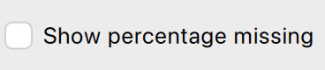
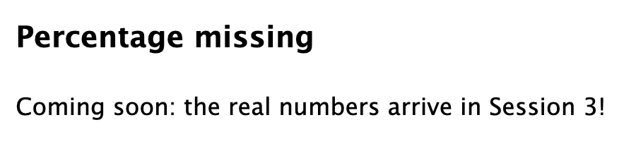
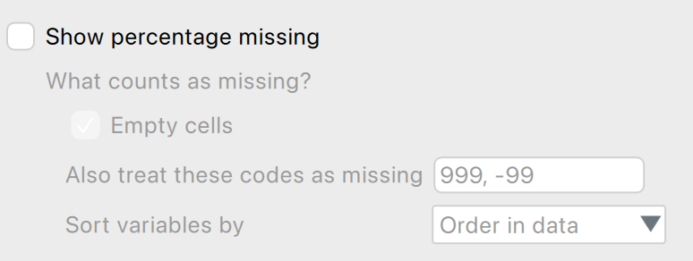
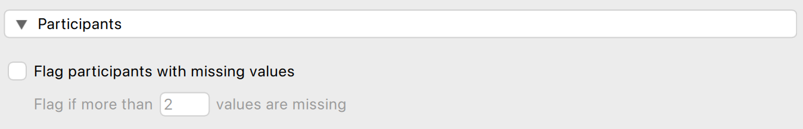

```{=html}
<button type="button" class="cs-toggle" id="cs-toggle" aria-expanded="false" aria-controls="cs-panel">📘 Cheat sheet</button><aside class="cs-panel" id="cs-panel" aria-label="Cheat sheet" hidden><div class="cs-head"><strong>📘 Cheat sheet</strong><button type="button" class="cs-close" id="cs-close" aria-label="Close">✕</button></div><table data-quarto-disable-processing="true"><tr><th>🔁 Edit loop</th><td>Save (<code>.qml</code> <em>or</em> <code>.R</code>) → <code>renv::install(".")</code> → JASP: <b>Install Developer Module</b> → reopen the analysis</td></tr><tr><th>📂 Files</th><td><code>inst/qml/missingValues.qml</code> = the window<br><code>R/missingValues.R</code> = the computation</td></tr><tr><th>☑️ CheckBox</th><td><code>CheckBox { name: "x"; label: qsTr("…") }</code></td></tr><tr><th>🌉 The bridge</th><td>QML <code>name: "showPercentage"</code> → R <code>options$showPercentage</code><br><small>Spelled <b>exactly</b> the same, capitals included</small></td></tr><tr><th>⏱️ When R runs</th><td>After <b>every</b> change in the window: the <b>whole</b> function, top to bottom</td></tr><tr><th>🧰 The function</th><td><code>missingValues &lt;- function(jaspResults, dataset, options)</code><br><small><b>options</b> = what the user clicked · <b>jaspResults</b> = where output goes · <b>dataset</b> = Session 3</small></td></tr><tr><th>📝 Some text</th><td><code>note &lt;- createJaspHtml(title = "…", text = "…")</code></td></tr><tr><th>📦 Put a box on the shelf</th><td><code>jaspResults[["myNote"]] &lt;- note</code><br><small>New label → new box · same label → box swapped</small></td></tr><tr><th>🔀 Only sometimes</th><td><code>if (options$x) { … } else { … }</code></td></tr><tr><th>🔗 Tag the box</th><td><code>note$dependOn("x")</code> → JASP throws the box off the shelf when <code>x</code> changes<br><code>note$dependOn(c("x", "y"))</code> → several options</td></tr><tr><th>⚠️ QML rules</th><td>Types start with a <b>Capital</b> · text goes in <b>"quotes"</b> · every <b>{</b> needs its <b>}</b></td></tr><tr><th>🆘 Stuck?</th><td>Compare with <code>controlPlayground.qml</code> and <code>controlPlayground.R</code>: they use every trick on this page</td></tr></table></aside>
```


```{=html}
<!--
  ✏️ HOW TO EDIT (for Leo)
  ⚠️ Edit this file in "Source" mode, NOT "Visual" mode.
  Same building blocks as session-01.qmd (see the notes at the top of that file).
  - Quest checklists ( - [ ] item ) save their ticks per section id, under the prefix jsdg-s2-.
  - Achievements (Wrap-up) unlock from the quests in #button, #bridge, #rcode, #fix and from the bug hunt.
  - Click "Render" to rebuild session-02.html.
-->
```

## Previously… 📺 [⏱ 5 min]{.timing} [0:00–0:05]{.timing .clock} {#previously}

*Previously, on JASP Student Developers…* Before you peek: can you still answer these? **Think first, then click.**

```{=html}
<div class="prev-reel">
  <button type="button" class="prev-card" aria-expanded="false"><span class="prev-n">01</span><strong>What is a JASP module, really?</strong><span class="prev-a">An <b>R package</b>, plus a few files that tell JASP what to show.</span><span class="prev-cue">Click to remember ↻</span></button>
  <button type="button" class="prev-card" aria-expanded="false"><span class="prev-n">02</span><strong>Which three files make one analysis?</strong><span class="prev-a">📋 <code>Description.qml</code>: the menu<br>🎛️ <code>inst/qml/….qml</code>: the window<br>📊 <code>R/….R</code>: the computation</span><span class="prev-cue">Click to remember ↻</span></button>
  <button type="button" class="prev-card" aria-expanded="false"><span class="prev-n">03</span><strong>You changed a file. Now what?</strong><span class="prev-a">💾 Save → <code>renv::install(".")</code> → JASP: <b>Install Developer Module</b> → reopen the analysis<br><small>You’ll do this a lot today. It’s also in the 📘 cheat sheet.</small></span><span class="prev-cue">Click to remember ↻</span></button>
  <button type="button" class="prev-card" aria-expanded="false"><span class="prev-n">04</span><strong>How did your heading get into the menu?</strong><span class="prev-a">A <code>GroupTitle { title: qsTr("…") }</code> block in <code>Description.qml</code>.</span><span class="prev-cue">Click to remember ↻</span></button>
</div>

```

## Welcome back! [⏱ 5 min]{.timing} [0:05–0:10]{.timing .clock} {#start}

Last time we stopped right after your first menu edit. Today we pick up from there, and go all the way from a **button** to **R**.

```{=html}
<div class="mission-win">🎯 <strong>Today's win:</strong> you tick your own button, and R answers.</div>
<div class="route-strip"><a href="#bughunt">🐛 Warm up</a><b>→</b><a href="#detectives">👯 Detectives</a><b>→</b><a href="#readqml">🎮 Predict the window</a><b>→</b><a href="#button">☑️ Button</a><b>→</b><a href="#bridge">🔄 Behind the scenes</a><b>→</b><a href="#rcode">🧠 R</a><b>→</b><a href="#predict">🔮 Predict</a><b>→</b><a href="#fix">🔧 Fix</a></div><p class="flip-hint">👆 Click a step to jump there</p>
```

Quick check before we start:

- [ ] 📊 RStudio: `jaspDataWrangling.Rproj` is open (the Console says *Project … loaded*)
- [ ] 🧮 JASP: **Dev: Data Wrangling → Missing Values** opens

```{=html}
<details class="stuck"><summary>😶‍🌫️ Missed Session 1, or your module is broken?</summary><p>No problem! Start from a fresh copy:</p><ol><li><a href="../module/jaspDataWrangling.zip" download>⬇️ Download the module</a> and unzip it.</li><li>Follow <a href="../session-01/session-01.html#install">Install the module</a> and <a href="../session-01/session-01.html#load">Load it in JASP</a> from Session 1.</li><li>Raise your hand if anything gets stuck. We’ll sort it out together.</li></ol></details>
```

## Warm-up: bug hunt 🐛 [⏱ 10 min]{.timing} [0:10–0:20]{.timing .clock} {#bughunt}

Last time, you edited the menu in `inst/Description.qml`. Let’s see how sharp your eyes are now.

Something went wrong in `Description.qml`… five times. Read the symptom, then **click the line you think is broken**.

```{=html}
<div class="bug-hunt" id="bug-hunt">
  <div class="bug-tabs" role="group" aria-label="Choose a bug"></div>
  <p class="bug-symptom" id="bug-symptom"></p>
  <div class="bug-code" id="bug-code" role="group" aria-label="Code lines: click the broken one"></div>
  <div class="bug-feedback" id="bug-feedback" aria-live="polite" hidden></div>
  <div class="bug-foot"><span id="bug-score">🐛 0 / 5 squashed</span><span class="bug-tip">Tip: in real life, compare with a version that works. Bugs hide in tiny details!</span></div>
  <script type="application/json" id="bug-data">[{"title": "Missing piece", "symptom": "After reinstalling, the whole Data Wrangling menu is gone. 😱", "lines": ["GroupTitle", "{", "    title: qsTr(\"Playground\")", "", "Analysis", "{", "    title: qsTr(\"Control Playground\")", "    func : \"controlPlayground\"", "    qml  : \"controlPlayground.qml\"", "}"], "bug": [1, 2, 3], "explain": "The GroupTitle block opens with <code>{</code> but never closes it. Every <code>{</code> needs its own <code>}</code>. One broken bracket and JASP can’t read the file at all, so the whole menu disappears.", "fix": "Add a <code>}</code> after <code>title: qsTr(\"Playground\")</code>."}, {"title": "Lost in translation", "symptom": "After reinstalling, your new heading doesn’t show up properly.", "lines": ["GroupTitle", "{", "    title: qsTr(Coming soon)", "}"], "bug": 2, "explain": "Text must always sit inside quotes: <code>\"Coming soon\"</code>. Without them, QML thinks <code>Coming</code> and <code>soon</code> are names of things that don’t exist.", "fix": "<code>title: qsTr(\"Coming soon\")</code>"}, {"title": "Big C, small c", "symptom": "The menu item is there, but clicking “Control Playground” doesn’t open the window.", "lines": ["Analysis", "{", "    title: qsTr(\"Control Playground\")", "    func : \"controlPlayground\"", "    qml  : \"ControlPlayground.qml\"", "}"], "bug": 4, "explain": "The file is called <code>controlPlayground.qml</code> with a small <em>c</em>. To a computer, <code>C</code> and <code>c</code> are different letters, so JASP can’t find the window.", "fix": "<code>qml: \"controlPlayground.qml\"</code>"}, {"title": "Typo", "symptom": "The menu item is there, but clicking “Control Playground” gives an error about a function it can’t find.", "lines": ["Analysis", "{", "    title: qsTr(\"Control Playground\")", "    func : \"controlPlaygorund\"", "    qml  : \"controlPlayground.qml\"", "}"], "bug": 3, "explain": "<code>controlPlaygorund</code>: the <em>o</em> and <em>u</em> swapped places. JASP looks for an R function with exactly this name, and there is none. Typos in names are invisible to the eye but fatal to the computer.", "fix": "<code>func: \"controlPlayground\"</code>"}, {"title": "Shrinking capital", "symptom": "After reinstalling, the whole Data Wrangling menu is gone. Again! 😩", "lines": ["groupTitle", "{", "    title: qsTr(\"Playground\")", "}"], "bug": 0, "explain": "QML building blocks always start with a <strong>capital</strong> letter: <code>GroupTitle</code>, <code>Analysis</code>, <code>CheckBox</code>. With a small <em>g</em>, QML doesn’t recognise it. (The settings inside, like <code>title</code>, start with a small letter.)", "fix": "<code>GroupTitle</code>"}]</script>
</div>
```

## Pair up: QML detectives 👯 [⏱ 10 min]{.timing} [0:20–0:30]{.timing .clock} {#detectives}

### 🧭 From the menu to the window

In the bug hunt you read `Description.qml`: the **menu**. But what happens when you *click* **Control Playground** in that menu? Look at its `Analysis` block again: **which line tells JASP which window to open?**

```{=html}
<details class="stuck"><summary>🔍 Check your answer</summary><p><code>qml : "controlPlayground.qml"</code>. Click the menu item, and JASP opens <code>inst/qml/controlPlayground.qml</code>: the window with all the controls. (And <code>func</code>? That one points to R. Later today!)</p></details>
<div class="anatomy-grid"><div class="anatomy-node is-done"><div class="anatomy-icon">📋</div><strong>Description.qml</strong><span>Menu</span><small>✅ Session 1</small></div><div class="anatomy-arrow">→</div><div class="anatomy-node is-now"><div class="anatomy-icon">🎛️</div><strong>controlPlayground.qml</strong><span>Window</span><small>👉 Now</small></div><div class="anatomy-arrow">→</div><div class="anatomy-node"><div class="anatomy-icon">📊</div><strong>controlPlayground.R</strong><span>Computation</span><small>⏳ Later today</small></div></div>
```

Every window file has the same shape: a `Form`, with the controls inside it.

``` qml
import JASP.Controls          // the box of building blocks

Form                          // the whole window
{
    info: qsTr("…")           // 🔍 detective mission #1!

    TextField                 // one control…
    {
        name : "yourName"     // the name R uses (more on that later today)
        label: qsTr("Your name")
    }

    // …more controls…
}
```

**Now read the real thing.** Work with your neighbour: **one of you opens the QML file, the other opens JASP.** Then solve these missions together, switching roles whenever you like:

```{=html}
<div class="role-cards">
  <div class="role-card role-code"><span class="role-icon">🕵️</span><strong>Code</strong><small>📊 RStudio · <code>inst/qml/controlPlayground.qml</code></small></div>
  <div class="role-swap" aria-hidden="true">⇄</div>
  <div class="role-card role-jasp"><span class="role-icon">🧭</span><strong>JASP</strong><small>🧮 Control Playground</small></div>
</div>
```

The first four: just look. The last two: **predict first**, then edit and check in JASP (the edit loop from 📺 *Previously*).

::: {#spot .quest-scope}
- [ ] **The welcome note.** Near the top of the file is a line starting with `info:`. Where does that text appear in JASP?
- [ ] **Ticked from the start.** Which boxes are already ticked when the window opens? Find the line that makes each one ticked.
- [ ] **The grey one.** Untick “Show histogram”. What happens to “Mark the mean”? Find the reason in the code.
- [ ] **The hidden drawer.** Some options are hidden when the window opens. Find them in JASP, and find what hides them in the code.
- [ ] **Wider box.** The *Your name* field has `fieldWidth: 160`. Change it to `300`. What happens?
- [ ] **Over the limit.** Type `20000` as *Sample size* in JASP. What happens? Change the code so `20000` is allowed.
:::

```{=html}
<details class="stuck"><summary>🔍 Reveal the answers (after you've tried!)</summary><p><code>info</code> is the help text behind the ⓘ button. Ticked at start: “Show histogram”, “Teal” and “Show what R received”, each with <code>checked: true</code>. Untick “Show histogram” and “Mark the mean” turns grey: it sits <em>inside</em> the “Show histogram” CheckBox, so it only works while its parent is ticked. The drawer is a <code>Section</code>. The name box gets wider. JASP won’t accept 20000 because of <code>max: 10000</code>: raise it to e.g. <code>max: 50000</code>.</p></details>
```

## Read the QML, predict the window 🎮 [⏱ 5 min]{.timing} [0:30–0:35]{.timing .clock} {#readqml}

One more detective skill before you build: read QML **without** JASP open, and picture the window in your head.

```{=html}
<div class="option-lab" id="option-lab" aria-label="Interactive QML prediction exercise">
  <div class="lab-top"><div><span class="kicker">INTERACTIVE · 3 MINI CHALLENGES</span><h4>Read it. Predict it. Reveal it.</h4><p>Read a few lines of QML, then predict what shows up in the JASP window.</p></div><div class="lab-progress" aria-live="polite"><strong id="lab-score">0 / 3</strong><small>solved</small></div></div>
  <div class="lab-switcher" role="group" aria-label="Choose challenge"><button type="button" class="lab-tab is-active" data-level="0" aria-pressed="true">01 · Label</button><button type="button" class="lab-tab" data-level="1" aria-pressed="false">02 · Ticked?</button><button type="button" class="lab-tab" data-level="2" aria-pressed="false">03 · Nested</button></div>
  <div class="lab-board">
    <div class="lab-pane"><div class="lab-pane-heading"><span>📄 THE QML</span><span class="lab-status">READ THIS</span></div><pre class="lab-code" id="lab-code"></pre><div class="lab-window"><span>🪟 JASP WINDOW</span><div id="lab-window" class="lab-window-body"></div></div></div>
    <div class="lab-pane lab-predict"><div class="lab-pane-heading"><span>🧠 YOUR PREDICTION</span><span class="lab-status">THINK FIRST</span></div><p class="lab-question" id="lab-question"></p><div class="lab-choices" id="lab-choices" role="group" aria-label="Possible outcomes"></div><button type="button" id="lab-check" class="lab-action" disabled>Check my prediction →</button><div id="lab-feedback" class="lab-feedback" aria-live="polite" hidden></div></div>
  </div>
  <div class="lab-bottom"><span>🔗 <strong>Remember:</strong> <code>label</code> is what users see · <code>name</code> is what R uses (more on that later today)</span><button type="button" id="lab-reset" class="lab-reset">↻ Try again</button></div>
  <p class="lab-disclaimer">Teaching simulation only: the mini window imitates JASP; it doesn't run JASP. Check your answers for real in Control Playground.</p>
</div>
```

```{=html}
<p class="gallery-link">🧰 Curious what else is in the toolbox? Every control, live and clickable: <a href="#bonus">see the control gallery in the Appendix →</a></p>
```

## Add your first button ☑️ [⏱ 10 min]{.timing} [0:35–0:45]{.timing .clock} {#button}

Time to build in **your own** window: **Missing Values**. Open `inst/qml/missingValues.qml`, look at the target picture, and rebuild it. Today it won’t just *look* right: by the end of the session, it will talk to R.

::: {.callout-note .option icon="false" collapse="false"}
## ⭐ A first question

*The Calm Minds team opens their data file and asks the obvious question: “How much of this is missing?” Before any numbers, they need a way to ask for them.*

**Build this:**

{.target-shot width=300 fig-alt="Target: a checkbox labelled Show percentage missing"}

```{=html}
<details class="stuck"><summary>💡 Hint 1</summary><p>You have seen a control exactly like this today. Where?</p></details>
<details class="stuck"><summary>💡 Hint 2</summary><p>Borrow it from <code>controlPlayground.qml</code>, change one thing, and paste it inside <code>Form { }</code>, below the Variables box.</p></details>
```
:::


- [ ] My checkbox shows up in Missing Values

## Behind the scenes 🔄 [⏱ 15 min]{.timing} [0:45–1:00]{.timing .clock} {#bridge}

Your checkbox is in the window. But what happens **behind the scenes** when you click it? Time to open the third file: `R/missingValues.R`. Let’s read it together.

### 🧰 One function, three parts

Find this line:

``` r
missingValues <- function(jaspResults, dataset, options)
```

This is the function JASP runs for **Missing Values**. It gets three things:

```{=html}
<div class="boxes3">
  <div class="box3 box-in"><div class="box3-icon">🎛️</div><code>options</code><b>What the user clicked</b><small>Comes <em>in</em> from the window on the left</small></div>
  <div class="box3 box-in is-later"><div class="box3-icon">🗂️</div><code>dataset</code><b>The data</b><small>Comes <em>in</em> from the data file<br>⏳ Session 3</small></div>
  <div class="box3 box-out"><div class="box3-icon">📥</div><code>jaspResults</code><b>The shelf</b><small>Every box you put on it shows up on the <em>right</em></small></div>
</div>
<div class="jasp-flow" aria-label="How the three boxes connect the two sides of JASP">
  <div class="jf-pane jf-left"><span class="jf-tag">🎛️ Left: the window</span><div class="jf-ctl">☑️ Show percentage missing</div><div class="jf-ctl">▤ Variables</div></div>
  <div class="jf-arrow jf-blue"><span>options</span><i></i></div>
  <div class="jf-mid"><div class="jf-fn">🧠 <code>missingValues()</code></div><div class="jf-up">↑</div><div class="jf-data">🗂️ <code>dataset</code><small>Session 3</small></div></div>
  <div class="jf-arrow jf-green"><span>jaspResults</span><i></i></div>
  <div class="jf-pane jf-right"><span class="jf-tag">📥 Right: the shelf</span><div class="jf-out"><em class="jf-key">[["welcome"]]</em><b>Under construction</b></div><div class="jf-out"><em class="jf-key">[["optionsSeen"]]</em><b>What R received</b></div></div>
</div>
```

```{=html}
<div class="concept"><div class="concept-head"><span>📦</span><b>New idea</b><strong>jaspResults is a shelf of boxes</strong></div><p>Picture <code>jaspResults</code> as a <b>shelf</b>. Everything you see on the right side of JASP is a <b>box</b> on that shelf, and every box has a <b>label</b>, like <code>[["welcome"]]</code>.</p><p>📦 A <b>new</b> label → a new box on the shelf. 🔄 The <b>same</b> label → the old box is swapped for the new one.</p><p>We’ll keep coming back to this shelf today.</p></div>
```


### 📖 Take it apart

Inside the function, the first thing it does is make the *Under construction* note you see in JASP. **Click each coloured part** to see what it does.

```{=html}
<div class="takeapart">
<div class="tk-code"><button type="button" class="tk" data-n="1">jaspResults</button><button type="button" class="tk" data-n="2">[["welcome"]]</button> <button type="button" class="tk" data-n="3">&lt;-</button> <button type="button" class="tk" data-n="4">createJaspHtml(</button>
    <button type="button" class="tk" data-n="5">title =</button> <button type="button" class="tk" data-n="7">gettext(</button>"Under construction"<button type="button" class="tk" data-n="7">)</button>,
    <button type="button" class="tk" data-n="6">text  =</button> <button type="button" class="tk" data-n="7">gettext(</button>"This analysis doesn't compute anything yet. …"<button type="button" class="tk" data-n="7">)</button>
  <button type="button" class="tk" data-n="4">)</button></div>
<div class="tk-panel" aria-live="polite"><p class="tk-empty">👆 Click a coloured part of the code.</p>
<p data-n="1" hidden><b>jaspResults</b>: the <b>shelf</b>. Every box on it shows up on the right side of JASP.</p>
<p data-n="2" hidden><b>[["welcome"]]</b>: the <b>label</b> on one box. The shelf can hold many boxes, and JASP shows each one as its own block on the right: look at the picture above, two labels, two blocks. A <b>new</b> label → a new box. The <b>same</b> label → the old box is swapped.</p>
<p data-n="3" hidden><b>&lt;-</b>: “put this on the shelf, in the box with that label”. Exactly like <code>&lt;-</code> in R Puzzles.</p>
<p data-n="4" hidden><b>createJaspHtml( … )</b>: makes what goes <em>inside</em> the box: a text block with a heading and some text. (JASP has others too: tables, plots… coming in later sessions!)</p>
<p data-n="5" hidden><b>title =</b>: the heading of the text block, in bold.</p>
<p data-n="6" hidden><b>text =</b>: the text underneath the heading.</p>
<p data-n="7" hidden><b>gettext( … )</b>: marks the text for <em>translation</em>, so JASP can show it in other languages. Optional for us: <code>title = "Hello"</code> works just as well.</p>
</div>
</div>
```

```{=html}
<details class="bubble"><summary>💬 Wait… <code>options$showPercentage</code> but <code>jaspResults[["welcome"]]</code>? <code>$</code> or <code>[[ ]]</code>?</summary>
<div class="bubble-body"><p>Both pick <b>one thing by its name</b> out of a list:</p>
<table data-quarto-disable-processing="true"><tr><th>You write</th><th>It means</th></tr>
<tr><td><code>options$showPercentage</code></td><td>the item called <code>showPercentage</code></td></tr>
<tr><td><code>options[["showPercentage"]]</code></td><td>exactly the same item: the name is just in quotes</td></tr>
<tr><td><code>jaspResults[["welcome"]]</code></td><td>the box labelled <code>welcome</code> on the shelf</td></tr></table>
<p>💡 <b>Rule of thumb for today:</b> read options with <code>$</code>, put boxes on the shelf with <code>[[" "]]</code>. The shelf is a special JASP object, so always use <code>[[" "]]</code> there.</p></div></details>
```

**Check yourself**, then peek:

```{=html}
<details class="stuck"><summary>1️⃣ You want the heading to say “Hello!”. Which part do you change?</summary><p>The text after <code>title =</code>: <code>title = "Hello!"</code>.</p></details>
<details class="stuck"><summary>2️⃣ How many blocks do you see on the right side of JASP? Find the line in <code>missingValues.R</code> that makes each one.</summary><p>Two blocks, two labels: <code>[["welcome"]]</code> makes <em>Under construction</em>, and <code>[["optionsSeen"]]</code> makes <em>What R received</em>.</p></details>
<details class="stuck"><summary>3️⃣ Two pieces of output use the same label. What happens?</summary><p>The second box is <b>swapped in</b> for the first: one label, one box. Keep that in mind for the next experiment…</p></details>
```

### ⏱️ R was here: when does R run?

You click a checkbox in JASP. What does R do? **Decide first:**

```{=html}
<div class="predict" data-key="when">
  <div class="predict-choices" role="group" aria-label="Your prediction">
    <button type="button" data-c="once">1️⃣ It ran once, when I opened the analysis</button>
    <button type="button" data-c="every">🔁 It runs again, every time I change something</button>
    <button type="button" data-c="part">✂️ It runs only the lines about that checkbox</button>
  </div>
  <p class="predict-go" hidden>🔒 Locked in! Now let’s find out.</p>
</div>
```

**The experiment:** give R a clock. You can read it now: same shape as the welcome note. Paste this into `R/missingValues.R`, inside the function, just above `return()`:

``` r
jaspResults[["clock"]] <- createJaspHtml(
  title = "R was here",
  text  = format(Sys.time(), "%H:%M:%S")
)
```

Now tick, untick, wait a few seconds, tick again… and keep an eye on the clock. ⏱️

```{=html}
<details class="stuck"><summary>🤔 So, when does R run? (after you’ve tried!)</summary><p>The clock jumps after <b>every</b> click. Every time you change anything in the window, JASP sends <em>all</em> the options to R, and R runs the <b>whole</b> function again, from the first line to <code>return()</code>:</p><div class="route-strip loop-strip"><span>👆 You change a control</span><b>→</b><span>📦 QML packs all options by <code>name</code></span><b>→</b><span>📨 JASP sends them to R</span><b>→</b><span>🔁 R runs the whole function</span><b>→</b><span>📦 Boxes go on the shelf</span><b>↺</b></div><p>Try it in slow motion below.</p>
```

```{=html}
<div class="shelf-sim" data-version="v1"><p class="ss-intro">A mini JASP in slow motion. Tick and untick the checkbox, and watch the log: R runs <b>all</b> the lines, every time. Same labels → the boxes are swapped, so the clock is always new.</p><div class="ss-grid"><div class="ss-pane ss-left"><span class="ss-tag">🎛️ The window</span><label class="ss-check"><input type="checkbox"> Show percentage missing</label><small class="ss-opt">options$showPercentage = <b>FALSE</b></small></div><div class="ss-pane ss-code"><span class="ss-tag">🧠 missingValues.R</span><ol class="ss-lines"></ol></div><div class="ss-pane ss-shelf"><span class="ss-tag">📥 The shelf: jaspResults</span><div class="ss-boxes"></div></div></div><ol class="ss-log" aria-live="polite"><li class="ss-hint">👆 Tick the checkbox to change an option…</li></ol><button type="button" class="ss-reset">↺ Start over</button></div>
```

```{=html}
</details>
```

```{=html}
<div class="prev-cliff">🧩 <b>Keep this in mind:</b> the clock is new after every click. Is <em>all</em> output new after every click? We’ll find out soon…</div>
```

::: {#bridge-check .quest-scope}
- [ ] I can name the three parts, and where each one shows up in JASP
- [ ] My clock shows the time, and I know when R runs
:::

## Your first R code 🧠 [⏱ 15 min]{.timing} [1:00–1:15]{.timing .clock} {#rcode}

Your turn to write R, in two small steps.

### ✍️ Step 1: put your own box on the shelf

```{=html}
<div class="goal-shot"><span class="goal-tag">🎯 Your goal: this box in the JASP output</span></div>
```

Use the same shape as the welcome note. This time we do it in **two moves**: first *make* the box, then *put it on the shelf*. (You’ll see why that’s handy later.) Fill in the blanks, and paste it inside the function, just above `return()`:

``` r
note <- createJaspHtml(
  title = "________",
  text  = "________"
)
jaspResults[["________"]] <- note
```

```{=html}
<details class="stuck"><summary>💡 Hint</summary><p><code>title</code> and <code>text</code> are just text: write anything you like, in quotes. The last blank is the label for your box: a short name in quotes that no other box on the shelf uses.</p></details>
<details class="stuck"><summary>🔓 Still stuck? Show the answer</summary><pre><code>note &lt;- createJaspHtml(
  title = "Percentage missing",
  text  = "Coming soon: the real numbers arrive in Session 3!"
)
jaspResults[["percentage"]] &lt;- note</code></pre></details>
```

Now tick and untick your checkbox. Your box is always there, just like the clock.

### 🤔 Wait… what if I *don’t* want it every time?

Your box shows up after every click, because R makes it in every run. But this box should only appear when the user **asks** for it: that’s what your checkbox is for! So, how does R know whether it’s ticked? Look at the output in JASP: the table **What R received**.

```{=html}
<div class="concept"><div class="concept-head"><span>🌉</span><b>New idea</b><strong>The name is the bridge</strong></div><p>The <code>name</code> you gave your CheckBox in QML is how R finds it:</p><pre>CheckBox { name: "showPercentage"; … }   →   options$showPercentage</pre><p>Remember <code>d$Age</code> from R Puzzles? <code>options</code> is a list too, and <code>$</code> picks one thing out of it. A ticked box arrives as <code>TRUE</code>, an unticked one as <code>FALSE</code>.</p></div>
```

### 🔀 Step 2: only when the checkbox is ticked

In R, “only when…” is spelled `if`. Wrap your box in it: you only add **two lines**, one above and one below.

``` r
if (options$________) {              # ⬅ new
  note <- createJaspHtml(
    title = "Percentage missing",
    text  = "Coming soon: the real numbers arrive in Session 3!"
  )
  jaspResults[["percentage"]] <- note
}                                     # ⬅ new
```

```{=html}
<details class="stuck"><summary>💡 Hint</summary><p>The blank: you just met it in <em>What R received</em>.</p></details>
<details class="stuck"><summary>🔓 Still stuck? Show the answer</summary><pre><code>if (options$showPercentage) {
  note &lt;- createJaspHtml(
    title = "Percentage missing",
    text  = "Coming soon: the real numbers arrive in Session 3!"
  )
  jaspResults[["percentage"]] &lt;- note
}</code></pre></details>
```

::: {#rcode-check .quest-scope}
- [ ] My own box shows up in JASP
- [ ] I found my checkbox in *What R received*: `TRUE` when ticked, `FALSE` when not
- [ ] Ticking the checkbox shows my box
:::

## Predict, then try 🔮 [⏱ 5 min]{.timing} [1:15–1:20]{.timing .clock} {#predict}

Your note is on screen. Now you **untick** the box. What happens to the note? **Decide first**, then try it in JASP.

```{=html}
<div class="predict" data-key="untick">
  <div class="predict-choices" role="group" aria-label="Your prediction">
    <button type="button" data-c="gone">💨 It disappears</button>
    <button type="button" data-c="stays">📌 It stays</button>
    <button type="button" data-c="error">💥 JASP shows an error</button>
  </div>
  <p class="predict-go" hidden>🔒 Locked in! Now untick the box in JASP… Were you right?</p>
</div>
<details class="stuck"><summary>🤔 What happened, and why? (after you’ve tried!)</summary><p>The note <b>stays</b>, even though the checkbox is unticked and your <code>if</code> is now <code>FALSE</code>.</p><p>Think of the shelf. JASP <b>keeps the shelf</b> from one run to the next, so it doesn’t have to rebuild everything after every click. R only <em>adds</em> or <em>swaps</em> boxes. The clock is swapped every run, so it’s always new. But once the checkbox is unticked, your <code>if</code> skips the note: nobody swaps it, nobody removes it. The old box is simply <b>left on the shelf</b>. 📌</p>
```

```{=html}
<div class="shelf-sim" data-version="v2"><p class="ss-intro">Replay it in slow motion: tick, then untick. Which box is left on the shelf, and why?</p><div class="ss-grid"><div class="ss-pane ss-left"><span class="ss-tag">🎛️ The window</span><label class="ss-check"><input type="checkbox"> Show percentage missing</label><small class="ss-opt">options$showPercentage = <b>FALSE</b></small></div><div class="ss-pane ss-code"><span class="ss-tag">🧠 missingValues.R</span><ol class="ss-lines"></ol></div><div class="ss-pane ss-shelf"><span class="ss-tag">📥 The shelf: jaspResults</span><div class="ss-boxes"></div></div></div><ol class="ss-log" aria-live="polite"><li class="ss-hint">👆 Tick the checkbox to change an option…</li></ol><button type="button" class="ss-reset">↺ Start over</button></div>
```

```{=html}
</details>
```

## Fix it 🔧 [⏱ 10 min]{.timing} [1:20–1:30]{.timing .clock} {#fix}

```{=html}
<div class="prev-cliff">🗄️ <b>Think first:</b> imagine <em>you</em> have to tidy this shelf before every run. How would you know which boxes to throw away, and which to keep?</div>
```

`controlPlayground.R` has the same situation: *Show what R received* is a checkbox too, and its output **does** disappear when you untick it. Open `R/controlPlayground.R`, find part 5 (*Behind the scenes*), and compare it with your code. **One line makes the difference.** Find it, and add your own version.

```{=html}
<details class="stuck"><summary>💡 Hint</summary><p>Look between the line that creates the output and the line that puts it in <code>jaspResults</code>.</p></details>
<details class="stuck"><summary>🔓 Still stuck? Show the answer</summary><pre><code>if (options$showPercentage) {
  note &lt;- createJaspHtml(
    title = "Percentage missing",
    text  = "Coming soon: the real numbers arrive in Session 3!"
  )
  note$dependOn("showPercentage")
  jaspResults[["percentage"]] &lt;- note
}</code></pre><p><code>dependOn</code> sticks a <b>tag</b> on the box: 🔗 <em>“throw me off the shelf when <code>showPercentage</code> changes.”</em></p></details>
<details class="stuck"><summary>🤔 Wait… your <code>dependOn</code> is <em>inside</em> the <code>if</code>. How can it work when the <code>if</code> is FALSE?</summary><p>Because the tag was stuck on the box <b>earlier</b>, in the run where the checkbox was ticked. And the tag is read by <b>JASP</b>, not by your code:</p><div class="route-strip loop-strip"><span>👆 You untick the checkbox</span><b>→</b><span>🧹 JASP checks the tags on the shelf, and throws off every box tagged <code>showPercentage</code></span><b>→</b><span>🧠 <em>Then</em> R runs: the <code>if</code> is FALSE, so no new note</span><b>→</b><span>✨ Shelf is clean</span></div>
```

```{=html}
<div class="shelf-sim" data-version="v3"><p class="ss-intro">Same slow motion, now with <code>dependOn</code>. Tick, then untick, and watch the 🧹 step.</p><div class="ss-grid"><div class="ss-pane ss-left"><span class="ss-tag">🎛️ The window</span><label class="ss-check"><input type="checkbox"> Show percentage missing</label><small class="ss-opt">options$showPercentage = <b>FALSE</b></small></div><div class="ss-pane ss-code"><span class="ss-tag">🧠 missingValues.R</span><ol class="ss-lines"></ol></div><div class="ss-pane ss-shelf"><span class="ss-tag">📥 The shelf: jaspResults</span><div class="ss-boxes"></div></div></div><ol class="ss-log" aria-live="polite"><li class="ss-hint">👆 Tick the checkbox to change an option…</li></ol><button type="button" class="ss-reset">↺ Start over</button></div>
```

```{=html}
</details>
```

- [ ] Unticking makes my note disappear
- [ ] Ticking brings it back

## One more, together 🤝 [If there’s time]{.optional-badge} {#levelup}

If we still have a few minutes, let’s do this one together.

::: {.callout-note .option icon="false" collapse="false"}
## 🤝 The other side

*An empty output looks broken. When the checkbox is **unticked**, put a friendly tip on the shelf instead: “Tick* Show percentage missing *to see the report.”*

```{=html}
<details class="stuck"><summary>💡 Hint 1</summary><p><code>if (…) { … } else { … }</code>: the <code>else</code> part runs when the condition is <code>FALSE</code>.</p></details>
<details class="stuck"><summary>💡 Hint 2</summary><p>Tick and untick a few times. Does your tip ever overstay its welcome? Think back to the 🔮 prediction, and to the tags on the boxes.</p></details>
<details class="stuck"><summary>🔓 Show the answer</summary><pre><code>} else {
  tip &lt;- createJaspHtml(title = "Tip", text = "Tick “Show percentage missing” to see the report.")
  tip$dependOn("showPercentage")
  jaspResults[["tip"]] &lt;- tip
}</code></pre><p>The tip needs its own tag too, or it stays on the shelf once you tick the checkbox.</p></details>
```
:::

## Wrap-up [⏱ 5 min]{.timing} [1:30–1:35]{.timing .clock} {#wrapup}

### 🏆 Achievements unlocked

Your badges light up by themselves as you tick off the missions on this page. How many did you collect?

```{=html}
<div class="ach" id="ach">
  <div class="ach-top"><span class="ach-count" aria-live="polite"><b id="ach-n">0</b> / 6</span><span class="ach-bar"><i id="ach-bar"></i></span></div>
  <div class="badge-grid ach-grid">
    <div class="loot-badge ach-badge" data-need="bugs:3"><span class="badge-icon">🐛</span><span class="badge-lock">🔒</span><strong>Bug Hunter</strong><small>You squashed at least three bugs.</small></div>
    <div class="loot-badge ach-badge" data-need="spot"><span class="badge-icon">🕵️</span><span class="badge-lock">🔒</span><strong>QML Detective</strong><small>You can read QML and find it in JASP.</small></div>
    <div class="loot-badge ach-badge" data-need="button"><span class="badge-icon">🛠️</span><span class="badge-lock">🔒</span><strong>Interface Builder</strong><small>You built your first control in your own window.</small></div>
    <div class="loot-badge ach-badge" data-need="bridge"><span class="badge-icon">🔄</span><span class="badge-lock">🔒</span><strong>Backstage Pass</strong><small>You know what R receives, and when it runs.</small></div>
    <div class="loot-badge ach-badge" data-need="rcode"><span class="badge-icon">🧠</span><span class="badge-lock">🔒</span><strong>R Whisperer</strong><small>Your button makes R do something.</small></div>
    <div class="loot-badge ach-badge" data-need="fix"><span class="badge-icon">🔧</span><span class="badge-lock">🔒</span><strong>Dependency Doctor</strong><small>Your output stays in sync with the button.</small></div>
  </div>
  <p class="ach-done" id="ach-done" hidden>🎉 Full house! See you at the next session.</p>
</div>
```

### 📅 What's next

```{=html}
<div class="next-cards">
  <div class="next-card practical"><span class="next-when">Thu 3 Dec · 15:00–16:30 · 📍 REC GS.08</span><strong>🧩 Practical 2</strong><p>Practise what you built today, at your own pace. Optional: drop in whenever you like.</p></div>
  <div class="next-card session"><span class="next-when">Thu 10 Dec · 11:30–13:00 · 📍 REC V0.12</span><strong>📊 Session 3: real data, real numbers</strong><p>Today your note said <em>coming soon</em>. Next time, Missing Values reads the mystery dataset and fills its first table.</p></div>
</div>
```

```{=html}
<div class="sign-off"><span class="sign-wave">👋</span><strong>Thank you for building with us today!</strong><p>Until next time, and happy coding.</p><em>Leo &amp; the JASP Student Developers</em></div>
```

## Appendix: more QML challenges 🧩 {#qmlmore}

Two window-building challenges from Session 1, for a practical or a rainy evening. Rebuild the target picture in `missingValues.qml`.

::: {.callout-note .option icon="false" collapse="true"}
## ⭐⭐ Missing isn't always empty

*Plot twist: the team didn’t only leave cells empty. Some research assistants typed `999`, others `-99`, whenever a participant skipped a question. A good tool lets users decide what counts as missing, and how to sort the report… but these settings only matter once someone actually asks for the report.*

**Build this:**

{.target-shot width=520 fig-alt="Target: a group titled What counts as missing? with an Empty cells checkbox (ticked), a text box with 999, -99, and a Sort variables by dropdown"}

```{=html}
<details class="stuck"><summary>💡 Hint</summary><p>Every control here also appears in <code>controlPlayground.qml</code> or in the <a href="#bonus">control gallery</a> in the Appendix 🧰</p></details>
```
:::

::: {.callout-note .option icon="false" collapse="true"}
## ⭐⭐⭐ Boss level: the vanishing participants

*Some participants skipped half the questionnaire. The team wants to spot them, but only when they ask for it. And this is an advanced option, so keep it tucked away until someone opens it.*

**Build this:**

{.target-shot width=760 fig-alt="Target: a fold-out section Participants with a checkbox Flag participants with missing values and a nested number field Flag if more than 2 values are missing, greyed out"}

No hints this time. 😈
:::

## Appendix: the control gallery 🧰 {#bonus}

Checkboxes are just the start. **Control Playground** uses a whole toolbox of controls; here they are, one by one. Every mini control below is clickable, so try them!

```{=html}
<div class="ctl-gallery"><div class="ctl-card"><div class="ctl-head"><span class="ctl-icon">✏️</span><strong>TextField</strong></div><p class="ctl-use">Free text, like a name or a title.</p><div class="ctl-mock"><label class="mk-row">Your name <input type="text" value="JASP" size="10"></label></div><details class="ctl-code"><summary>Show the QML</summary><div class="ctl-pre"><button type="button" class="ctl-copy">Copy</button><pre><code>TextField
{
    name        : &quot;yourName&quot;
    label       : qsTr(&quot;Your name&quot;)
    defaultValue: &quot;JASP&quot;
}</code></pre></div></details></div><div class="ctl-card"><div class="ctl-head"><span class="ctl-icon">🔢</span><strong>IntegerField</strong></div><p class="ctl-use">Whole numbers only, with limits.</p><div class="ctl-mock"><label class="mk-row">Sample size <input type="number" value="100" min="2" max="10000" step="1"></label></div><details class="ctl-code"><summary>Show the QML</summary><div class="ctl-pre"><button type="button" class="ctl-copy">Copy</button><pre><code>IntegerField
{
    name        : &quot;sampleSize&quot;
    label       : qsTr(&quot;Sample size&quot;)
    defaultValue: 100
    min         : 2
    max         : 10000
}</code></pre></div></details></div><div class="ctl-card"><div class="ctl-head"><span class="ctl-icon">🎯</span><strong>DoubleField</strong></div><p class="ctl-use">Numbers with decimals (and minus signs, if you allow them).</p><div class="ctl-mock"><label class="mk-row">Mean <input type="number" value="0" step="any"></label></div><details class="ctl-code"><summary>Show the QML</summary><div class="ctl-pre"><button type="button" class="ctl-copy">Copy</button><pre><code>DoubleField
{
    name          : &quot;mean&quot;
    label         : qsTr(&quot;Mean&quot;)
    defaultValue  : 0
    negativeValues: true
}</code></pre></div></details></div><div class="ctl-card"><div class="ctl-head"><span class="ctl-icon">🎚️</span><strong>Slider</strong></div><p class="ctl-use">Drag to pick a value in a range.</p><div class="ctl-mock"><label class="mk-row mk-slider">SD <input type="range" min="0.1" max="5" step="0.1" value="1"><output>1.0</output></label></div><details class="ctl-code"><summary>Show the QML</summary><div class="ctl-pre"><button type="button" class="ctl-copy">Copy</button><pre><code>Slider
{
    name    : &quot;sd&quot;
    label   : qsTr(&quot;Standard deviation&quot;)
    value   : 1
    min     : 0.1
    max     : 5
    decimals: 1
}</code></pre></div></details></div><div class="ctl-card"><div class="ctl-head"><span class="ctl-icon">🔽</span><strong>DropDown</strong></div><p class="ctl-use">Pick one option from a list.</p><div class="ctl-mock"><label class="mk-row">Random seed <select><option>42</option><option>2026</option><option>123</option></select></label></div><details class="ctl-code"><summary>Show the QML</summary><div class="ctl-pre"><button type="button" class="ctl-copy">Copy</button><pre><code>DropDown
{
    name  : &quot;seed&quot;
    label : qsTr(&quot;Random seed&quot;)
    values: [&quot;42&quot;, &quot;2026&quot;, &quot;123&quot;]
}</code></pre></div></details></div><div class="ctl-card"><div class="ctl-head"><span class="ctl-icon">🔘</span><strong>RadioButtonGroup</strong></div><p class="ctl-use">Exactly one of a few choices, all visible at once.</p><div class="ctl-mock"><div class="mk-group-title">Bar colour</div><label class="mk-row"><input type="radio" name="mkc" checked> Teal</label><label class="mk-row"><input type="radio" name="mkc"> Orange</label><label class="mk-row"><input type="radio" name="mkc"> Purple</label></div><details class="ctl-code"><summary>Show the QML</summary><div class="ctl-pre"><button type="button" class="ctl-copy">Copy</button><pre><code>RadioButtonGroup
{
    name : &quot;barColor&quot;
    title: qsTr(&quot;Bar colour&quot;)
    RadioButton { value: &quot;teal&quot;;   label: qsTr(&quot;Teal&quot;); checked: true }
    RadioButton { value: &quot;orange&quot;; label: qsTr(&quot;Orange&quot;) }
    RadioButton { value: &quot;purple&quot;; label: qsTr(&quot;Purple&quot;) }
}</code></pre></div></details></div><div class="ctl-card"><div class="ctl-head"><span class="ctl-icon">🗂️</span><strong>Group</strong></div><p class="ctl-use">A titled box that keeps related controls together.</p><div class="ctl-mock"><div class="mk-group-title">Simulate data</div><div class="mk-indent"><label class="mk-row">Sample size <input type="number" value="100"></label><label class="mk-row">Mean <input type="number" value="0"></label></div></div><details class="ctl-code"><summary>Show the QML</summary><div class="ctl-pre"><button type="button" class="ctl-copy">Copy</button><pre><code>Group
{
    title: qsTr(&quot;Simulate data&quot;)

    IntegerField { name: &quot;sampleSize&quot;; label: qsTr(&quot;Sample size&quot;) }
    DoubleField  { name: &quot;mean&quot;;       label: qsTr(&quot;Mean&quot;) }
}</code></pre></div></details></div><div class="ctl-card"><div class="ctl-head"><span class="ctl-icon">📂</span><strong>Section</strong></div><p class="ctl-use">A fold-out area for extra options, closed by default.</p><div class="ctl-mock"><details class="mk-section"><summary>Behind the scenes</summary><label class="mk-row"><input type="checkbox" checked> Show what R received</label></details></div><details class="ctl-code"><summary>Show the QML</summary><div class="ctl-pre"><button type="button" class="ctl-copy">Copy</button><pre><code>Section
{
    title: qsTr(&quot;Behind the scenes&quot;)

    CheckBox { name: &quot;showOptions&quot;; label: qsTr(&quot;Show what R received&quot;) }
}</code></pre></div></details></div></div>
```

**How to try one for real:** copy a snippet into `inst/qml/missingValues.qml` (inside the `Form { }`), save, and reinstall (the usual edit loop). All of them live in `inst/qml/controlPlayground.qml` too, if you want to see them in context.

```{=html}
<details class="stuck"><summary>🧩 Mini challenge: tweak the Slider</summary><p>Make the Slider run from <code>0</code> to <code>100</code>, start at <code>50</code>, and show no decimals. Which three lines do you change? (Answer: <code>min</code>, <code>max</code> and <code>value</code>, plus <code>decimals: 0</code>.)</p></details>
```

